# Auditoría Técnica y de Producto — AgendaPro (`agendapro.com/mx` & `app.agendapro.com`) con REA

> [!NOTE]
> **Estado de la auditoría:** **COMPLETADA (Fase 1 + Fase 2A App Autenticada + Fase 2B Reservas Online con REA)**. Toda la inspección sobre la cuenta autenticada se realizó en modo **100% solo lectura** (sin crear, editar, cancelar, cobrar ni enviar mensajes). Ninguna credencial, cookie, token ni PII privado de clientas reales se incluye en este informe.

---

## 1. Registro Consolidado de Evidencia (REA + Navegador Verificado)

El bundle canónico completo de **REA** (**53.4 MB**, **46 registros canónicos**, 0 errores de exportación) se guardó en `../rea-evidence/rea_full_evidence_bundle.json.gz`. Todas las afirmaciones distinguen **observaciones directas** (capturas CDP/DOM/scripts exportados y capturas autenticadas verificadas por `BROWSER_HOST_FACTS`) de **inferencias estáticas** (rutas y endpoints recuperados de bundles JS sin ejecutar código del target).

| Evidencia / Fuente | Operación | Target / Alcance | Hallazgo clave |
| :--- | :--- | :--- | :--- |
| `ev_f88dc428…` | REA `inspect_web_page` | `https://agendapro.com/mx` | Next.js 16.4.6 App Router + Turbopack + Cloudflare + RSC + Mixpanel/HubSpot |
| `ev_8f7407f9…` | REA `analyze_web_bundle` | `agendapro.com` + `cdn.agendapro-resources.com` | 23 chunks Turbopack (225,559 nodos AST), 39 rutas y rediseño 2026 (`empleados-ia/*`, `Alma IA`) |
| `ev_3485d394…` | REA `export_web_scripts` | Landing MX + CDN + `/mx/planes` | 21 scripts inline RSC + 23 chunks CDN + 29 scripts de planes verificados por SHA-256 |
| `ev_a0c3ba29…` | REA `inspect_web_page` | `https://app.agendapro.com/sign_in?variant=legacy` | Shell **Single-SPA (40 microfrontends)** + SystemJS + Vite + PostHog + Sentry + Churnkey |
| `ev_c988f843…` | REA `analyze_web_bundle` | `https://app.agendapro.com/sign_in?variant=legacy` | 18 scripts (311,616 nodos AST), `agendapro-root-config` v26.11.19 + `user-auth` |
| `BROWSER_HOST_FACTS` (`25b1131b…`) | Auditoría autenticada solo lectura (6 bloques) | `https://app.agendapro.com/*` (37 rutas internas) | Menús completos, Agenda + Popover + Buscador Rápido + POS (`cart.agendapro.com`), Caja, CRM/Ficha 7 pestañas, Fidelización, Recordatorios, Crece, Inventario, Reportes, SmartPricing, PINs y 13 pestañas de Configuraciones |
| `ev_bab42f34…` | REA `inspect_web_page` + `export_web_scripts` | `https://cocoa.site.agendapro.com/mx/sucursal/602003` | Motor público de Reservas Online (Next.js Pages Router), 24 scripts exportados incl. `_buildManifest.js` (17 rutas) y contratos `/v1/minisite/*` |
| `ev_05b02625…` / `ev_6fd1f6d2…` | REA `analyze_web_bundle` + `inspect_analysis_view` | `https://cocoa.site.agendapro.com/mx/sucursal/602003` | 23 scripts analizados (**902,090 nodos AST**), señales de `smart_pricing`, `waitlist`, `deposit`, `consent`, `otp`, `home_service`, `videocall` |
| `ev_277d70f1…` – `ev_c8a78ef6…` + `BROWSER_HOST_FACTS` | Capturas verificadas | 19 PNGs en `screenshots/01…` a `19…` | Cobertura visual completa de Landing, Precios MX, Rediseño 2026, App Interna y Reservas Online |

> [!IMPORTANT]
> **Limitaciones y desconocidos explícitos:**
> 1. Los source maps (`*.js.map`) no están expuestos públicamente (`source_maps: unavailable`).
> 2. En `analyze_web_bundle` sobre `cocoa.site.agendapro.com`, 1 chunk grande alcanzó el límite por script de `30,000 ms` (`scr_a665831f…`), quedando como desconocido parcial de AST; los otros 23 scripts (902,090 nodos) sí se analizaron y los 24 archivos se exportaron completos.
> 3. La cuenta autenticada está en modo prueba de 7 días (sin terminal POS física conectada, sin campañas enviadas ni historial masivo), por lo que las vistas pobladas de `Propinas`, `Análisis Agente IA` y `Encuestas` solo mostraron su diseño/estado de activación y contratos estáticos.

---

## 2. Evidencia Visual Capturada (19 Pantallas Verificadas)

### 2.1 Superficie Pública, Precios MX, Rediseño 2026 (`Alma IA`) y Reservas Online


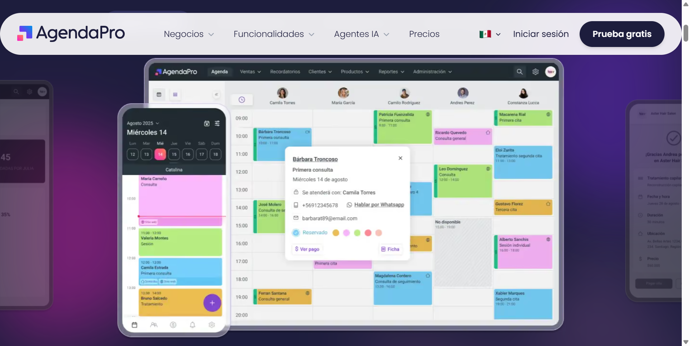

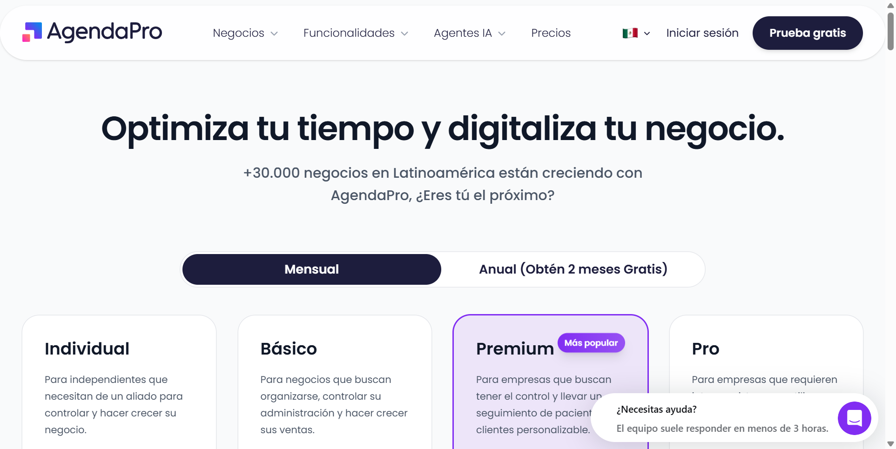


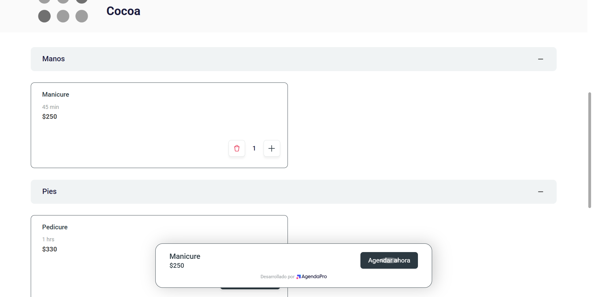

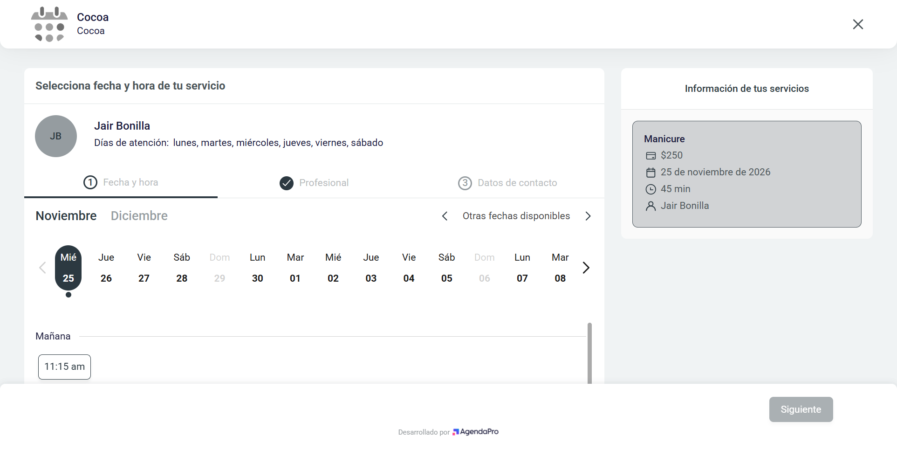


### 2.2 Aplicación Interna Autenticada (`https://app.agendapro.com`)

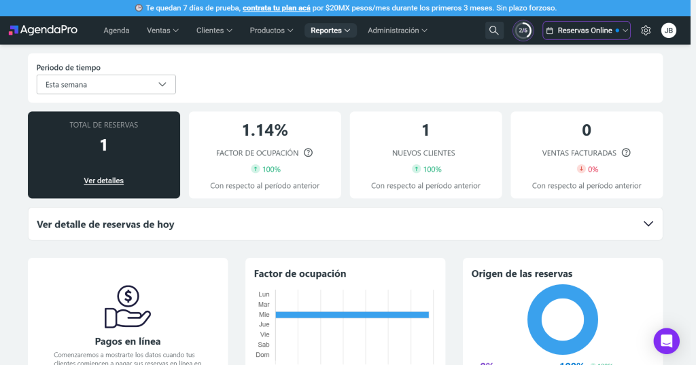

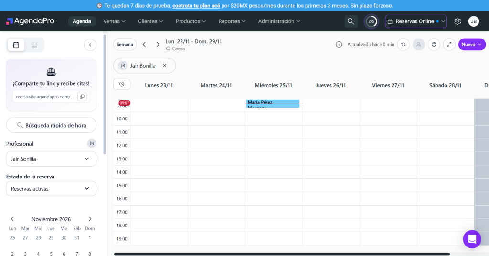

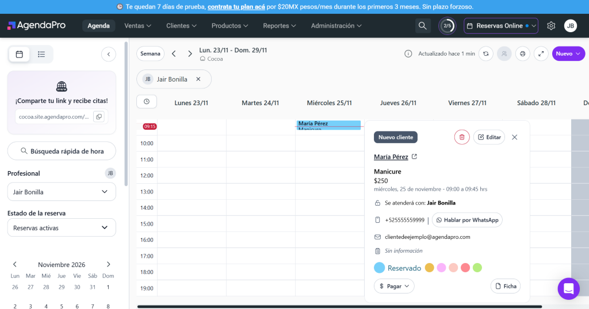

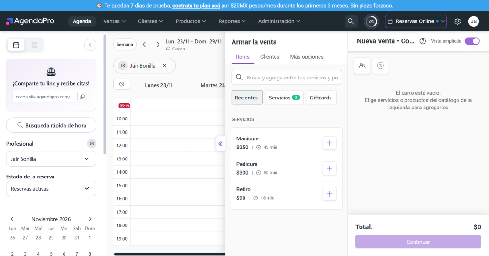

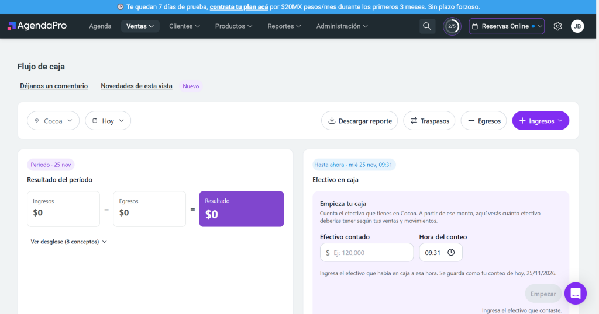

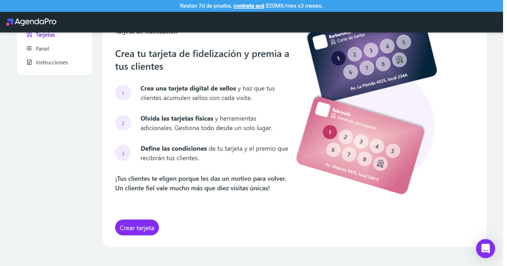

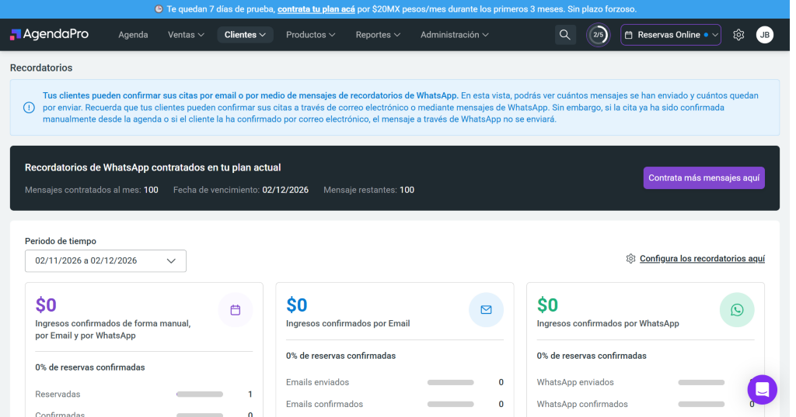

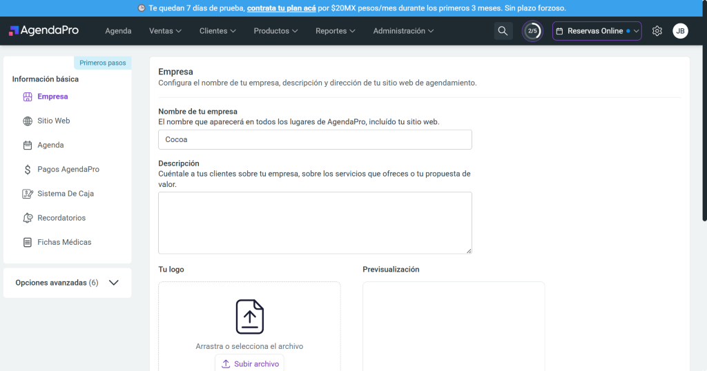


---

## 3. Arquitectura y Contratos API Descubiertos

AgendaPro separa su plataforma en **4 aplicaciones independientes** detrás de `ap-api.agendapro.com`:

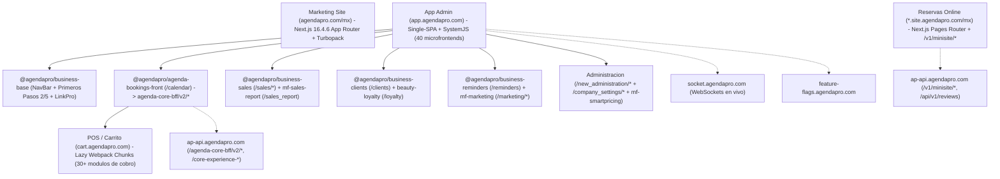

### Contratos de Endpoints Observados (Sin Credenciales ni PII)

- **Agenda Core BFF (`/agenda-core-bff/v2/*`, observación directa en `/calendar`):**
  - `GET /providers`, `POST /providers/availability`, `GET /services`, `GET /time_resources`
  - `GET /locations/:id/open-days`, `GET /available_days`, `GET /available_slots`, `GET /calendar_events`
  - `POST /bookings/preview` *(validación previa de precio, duración y conflictos en servidor antes de guardar)*
  - `GET /bookings/:id`, `GET /bookings/:id/payment-options` *(opciones dinámicas de cobro por cita: POS, WhatsApp, Pago manual)*
  - `GET /clients`, `GET /clients/form-fields`, `GET /whatsapp_templates`
- **Motor Público de Reservas Online (`*.site.agendapro.com`, exportado con REA):**
  - **17 rutas en `_buildManifest.js`:** `/[countryCode]/sucursal/[locationId]`, `/sucursal/[locationId]/profesional/[providerId]`, `/:countryCode/iframe/:path*`, `/bookings/confirm/[code]`, `/bookings/confirm_all/[code]`, `/bookings/cancel/[code]`, `/bookings/cancel_all/[code]`, `/bookings/edit/[code]`, `/bookings/review/[code]`, `/sign_consents/my_consent`.
  - **API Minisite (`/v1/minisite/*`):** `/overview`, `/locations`, `/catalog`, `/service-providers`, `/social-networks`, `/available-days`, `/available-hours`, **`/sooner-available-hours`** *(próximo hueco más cercano)*, `/client-check`, `/booking-info`, `/api/v1/location_reviews`, `/api/v1/promotion_campaign`.
- **Chunks Lazy del POS (`cart.agendapro.com/v26.11.25.130637/`):**
  - `LazyServiceSelection`, `LazyAssociateClient`, `LazyEditItem`, `LazyAssociateSeller`, `LazyAssociateItemSeller`, `LazyRetrieveCarts`, `LazySaveBudget`, `LazyMultiplePaymentMethods`, `LazyDownPayment`, `LazyInstallments`, `LazySelectTip`, `LazyCartLinkWhatsappSend`, `LazySendReceipt`, `LazyGiftCardConfirmation`, `LazyCartLocked`, `LazyAssociateTransaction`, `LazyConfirmationPOS`.

---

## 4. Auditoría Funcional Profunda de la App Interna (37 Rutas)

### 4.1 Dashboard y Onboarding (`/`)
- **Onboarding gamificado (`2/5` — `Primeros pasos`):** círculo de progreso persistente en navbar que guía la activación (catálogo, horarios, link de reservas) sin bloquear el uso.
- **Dashboard con widgets reordenables (`⋮⋮` drag-and-drop):** 4 KPI cards (`Total de reservas`, `Factor de ocupación %`, `Nuevos clientes`, `Ventas facturadas` con delta vs periodo anterior), acordeón `Ver detalle de reservas de hoy`, y 8 tarjetas visuales (`Pagos en línea`, `Factor de ocupación Lun–Dom`, `Origen de las reservas`, `Ventas facturadas`, `Recordatorios WhatsApp`, `Recordatorios Email`, `Campañas Email`, `Cumpleaños de hoy`).

### 4.2 Agenda (`/calendar`) — El Corazón Operativo
- **Granularidad adaptable del grid:** selector de duración de slot (`5, 10, 15, 20, 30, 40, 45, 60 min`), vistas Calendario y Lista (`agrupada`/`desagrupada`), botón `Ajustar columnas para ver a todos los profesionales`, pantalla completa e impresión.
- **Tarjeta fija `¡Comparte tu link y recibe citas!`** en la barra izquierda con copia en 1 clic.
- **`Búsqueda rápida de hora` (Quick Slot Finder):** permite encadenar **múltiples servicios** (`+ Agregar nuevo servicio`), elegir profesional o `Sin preferencia`, y muestra de inmediato una cinta horizontal de días + botones `Mañana`/`Tarde` libres. Ideal para recepción atendiendo llamadas o WhatsApp.
- **`Nueva Reserva`:** estado inicial seleccionable (6 estados), **repetición recurrente** (`Diaria`/`Semanal`/`Mensual`, días de semana, N repeticiones), **candado de preferencia de profesional** (`Bloquear profesional`), creación inline de cliente sin salir del modal, **precio editable**, separación entre **`Notas compartidas con el cliente`** y **`Nota interna`**, botón `Agregar otra reserva` (citas encadenadas) y guardia `Descartar cambios`.
- **`Bloqueo de horas`:** multi-selección de especialistas, motivo/etiqueta, rango en incrementos de 5 min y **recurrencia completa** (`Diariamente`/`Semanalmente`/`Mensualmente` hasta fecha o N repeticiones).
- **Popover rápido de cita (1 clic):** badge `Nuevo cliente`, candado de preferencia, botón inline **`Hablar por WhatsApp`**, **6 puntos de estado de 1 clic** (`Reservado`, `Confirmado`, `Asiste`, `No asistió`, `Pendiente`, `En espera`), botón split **`$ Pagar v`** (`Cobrar con POS`, `Cobrar por WhatsApp`, `Pagar`) y acceso directo a **`Ficha`**.
- **Leyenda de 27 indicadores:** distingue origen (`Sitio Web`, `Market`, `Charly IA`), modalidad (`Domicilio`, `Videollamada`), pago (`Pago pendiente`, `Abonada [A]`, `Pagada [$]`, `POS`), `Plan reservado [P]`, `Paquete` y preferencia con/sin candado.

### 4.3 POS Lateral y Módulo de Ventas (`/sales/*` + `cart.agendapro.com`)
- **POS en drawer lateral sobre la Agenda (`Armar la venta` + `Vista ampliada`):** no saca a recepción del calendario.
- **Al asociar una clienta**, muestra 5 bandejas financieras en vivo: `Ventas abonadas`, `Servicios por pagar`, `Tratamientos por pagar`, `Presupuestos` y `Carros guardados`.
- **Acciones avanzadas en `Más opciones`:** `Guardar carro` (carrito estacionado), `Recuperar carro o presupuesto`, `Guardar como presupuesto`, **`Vender carro como gift card`** (convierte cualquier combo de servicios en tarjeta de regalo en 1 clic), `Descuento a la venta` (`%` o `\$`), descuento y profesional **por línea de ítem**.
- **Checkout flexible (`Método de pago`):** Efectivo (con cálculo de cambio), Tarjeta Crédito/Débito, Transferencia, Giftcard, Terminal, **`Múltiples métodos de pago`** (pago dividido), **`Abono`** (pago parcial con saldo pendiente) y **`Enviar carro`** (link de cobro por WhatsApp).
- **`Resumen de ventas` (`/sales/summary`):** gráfico **waterfall de fuga de ingresos** (`\$250 agendados que no se cobraron` — reservas sin marcar `Asiste` y sin venta) con CTA directo **`Ir a cobrar`**.
- **`Flujo de caja` (`/sales/cash-flow`):** bloque `Ingresos − Egresos = Resultado` con desglose de 8 conceptos + tarjeta `Empieza tu caja` (`Efectivo contado` + `Hora del conteo`) + **9 pestañas contables** (`Pagadas`, `Pago parcial`, `Gift cards`, `Sin venta`, `Ventas internas`, `Otros ingresos`, `Egresos`, `Traspasos`, `Rectificaciones`).
- **`Reporte de comisiones` (`/sales/commissions`) y `/administration/commissions`:** separa comisiones en 3 pestañas (`Servicios`, `Planes`, `Productos`) + `Cobros por ventas internas`, editable por profesional o por servicio.
- **`Propinas` (`/sales/tips`):** **limitación detectada de AgendaPro** — solo funciona si contratas y cobras con su terminal POS física (`"Cobra con el POS de AgendaPro y podrás ver las propinas acá"`).

### 4.4 CRM de Clientes, Ficha, Fidelización y Encuestas (`/clients`, `/loyalty`, `/surveys_reports`)
- **Segmentación con filtro inverso en `/clients`:** filtro `¿Ha reservado?` con opción **`No tiene reserva según los filtros`** en un rango de fechas + botón **`Crear una audiencia con este listado`** (clave para detectar clientas que vinieron a uñas hace 21–45 días y no han vuelto), además de importación masiva y fusión de duplicados.
- **Ficha de Cliente (`/clients/:id`) — 7 pestañas + 5 paneles laterales:**
  - *Pestañas:* `Actividad` (7 contadores por estado), `Asistencia`, **`Pagos y deudas`** (4 KPIs: `Total pagado`, `Deuda total`, `Pendiente abonos`, `Reservas sin pagos`), `Fichas` (clínicas/técnicas + **generador con IA Beta** desde texto o PDF en `/company_settings/charts`), `Consentimiento` (PDF + envío por email o **`Firma presencial`** en tablet), `Encuestas`, `Fidelización` + botón **`Descargar datos`** (cumplimiento ARCO/LFPDPPP).
  - *Paneles laterales:* `Sesiones`, `Planes`, `Mensajería`, `Comentarios`, `Archivos` (carpetas para fotos antes/después de uñas).
- **Fidelización (`/loyalty`):** **Tarjeta digital de sellos** (1 sello por visita, máx. 1 sello/día/local, configurable de **3 a 10 sellos**, 6 colores, premio = `Servicio gratis` o `% Descuento` con tope opcional, vigencia 1–12 meses o sin vigencia) + Panel con KPIs (`Canjes realizados`, `Clientes activos`) y lista accionable **`Clientes cerca de su premio`**.
  - *Debilidad de AgendaPro:* obliga a la clienta a instalar la app de AgendaPro para ver sus sellos.

### 4.5 Recordatorios, Marketing (`Crece`), Inventario y Reportes
- **Recordatorios en cascada (`/reminders`):** envía **Email primero** (ej. 2 días antes) y **WhatsApp después** (1 día antes o 3 h antes) **solo si la cita no fue confirmada por Email o manualmente** — optimizando costos de mensajería. Mide el impacto en **`\$ Ingresos confirmados`** (no solo mensajes) e incluye log **`Reservas sin recordatorios`** para rescate manual.
  - *Limitación de AgendaPro:* cuota rígida de 100 WA en prueba / \$100 MXN por cada 50 mensajes en producción, y solo 50 emails/mes incluidos en Email Marketing.
- **Plantillas WhatsApp (`/administration/whatsapp_templates`):** 7 plantillas listas (incluyendo **`Recapturar reservas canceladas`** y `Descuento por cumpleaños`) con variables dinámicas clicables y vista previa móvil.
- **`Crece` (`/marketing/client_recovery`):** interruptor de 1 clic para reactivar clientas inactivas a 45 días con atribución directa (`Reservas agendadas`, `Ingresos totales`, tasa de apertura/clics).
- **Inventario (`/products/inventory`):** separa **`Costo de compra`**, **`Precio de venta al público`**, **`Precio de venta interna`** (consumo/venta a staff) y **`Comisión de venta %`**, con código de barras, deducción automática en POS y alertas por umbral o calendario mensual.
- **Reportes (`/bookings-reports` y `/sales_report`):** `General` (Ocupación %, Tasa de inasistencias %, **heatmap de reservas por hora Lun–Dom**, Top 3 servicios, Recaudación estimada), `Historial` (columnas editables + export), **`Rendimiento por profesional`** (reservas, ocupación, recaudación, **clientes nuevos vs recurrentes** por manicurista) y `Reporte de ventas` (ticket promedio + `Análisis Agente IA`).

### 4.6 Administración Avanzada, Precios Inteligentes y Seguridad Operativa
- **Precios inteligentes (`/new_administration/smartpricing`):** muestra mapa de calor de ocupación por día/hora comparado contra comercios similares y propone descuentos automáticos **20%–40%** en horas muertas (ej. martes mañana) con vista previa antes de activar.
- **Códigos de autorización / PIN de cajero (`/company_settings/authorization_codes`):** exige un PIN de autorización para 3 acciones críticas: **acciones de reservas** (cancelar/borrar), **acciones de caja** (descuentos/edición de precios/egresos) y **descargar archivos y reportes** (previene robo de base de clientas por staff saliente).
- **Reglas de blindaje de Agenda (`/company_settings/calendar`):** `Bloquear la edición de citas pasadas`, `Limitar cantidad de citas que puede agendar un cliente`, `Reservas internas fuera de horario`, `Ficha requerida` y control de traslapes/recursos.
- **Servicios y Paquetes (`/new_administration/services` y `/administration/memberships`):** soporta `Servicios`, `Clases`, `Paquetes` + **`Carga masiva de precios`** + **Planes `Estándar` y `Elección Libre`** (bolsa de N sesiones utilizables entre varios servicios con vencimiento y comisión).
- **Recursos con horario (`/administration/resources`):** modela sillones de pedicure / mesas / cabinas con horario propio vinculados a servicios.
- **LinkPro (`/company_settings`):** tarjeta tipo Linktree integrada para biografía de Instagram/TikTok + código `<iframe>` embebible en `/company_settings/integration`.

### 4.7 Reservas Online (`*.site.agendapro.com/mx`) vs. `/reservar` en `nails`
- **Qué hace bien AgendaPro:** carrito **multi-servicio** flotante (`Manicure + Pedicure + Retiro` en una sola cita), enlace directo por especialista (`/profesional/[id]`), endpoint `/sooner-available-hours`, confirmación/cancelación grupal (`confirm_all`/`cancel_all`), firma remota de consentimiento (`/sign_consents/my_consent`), y flujo limpio en 3 pasos (`Fecha y hora` → `Profesional` → `Datos de contacto`) con cinta de 14 días.
- **Dónde `nails` ya es superior:**
  1. **Cero marca de agua** (AgendaPro imprime `Desarrollado por AgendaPro` y banners promocionales propios en el sitio del salón; cobrar marca propia y Pixel cuesta **\$1,500–\$4,500 MXN/mes**).
  2. **Hold real de 3 minutos con contador en vivo + tiempo real** y recuperación de colisión `409` con 3 alternativas sin borrar el formulario.
  3. **Experiencia especializada en uñas:** galería *"Quiero este diseño"* con precarga, carga de **foto inspo**, 3 vistas Cal.com (`Mes`/`Semana`/`Columnas`) y encuesta post-cita con embudo a Google Maps.
  4. **Sin fricción de app externa:** AgendaPro empuja al login en `market.agendapro.com` / app móvil; `nails` opera directo en web/PWA brandeada.

---

## 5. Comparativa de Precios MX y Ventaja Competitiva de `nails`

| Plan AgendaPro MX | Precio MXN/mes (+ IVA) | Qué bloquea AgendaPro que `nails` puede dar nativo |
| :--- | :--- | :--- |
| **Individual** | \$299 (1 prof.) | Bloquea comisiones, inventario, alertas stock, fichas, encuestas, cumpleaños, giftcards y marca propia. |
| **Básico** | \$550 (2 prof.) | Bloquea URL/colores propios, vínculo Agenda–WhatsApp, fichas, consentimientos, encuestas, cumpleaños y giftcards. |
| **Premium** | \$1,500 | Sigue cobrando aparte WhatsApp (\$100/50 msgs), Terminal POS (\$250/mes + 2.29% — obligatoria para **Propinas**), Charly IA (\$1,000/mes) y bloquea API / Meta Pixel / GA4. |
| **Pro** | \$4,500 | Recién desbloquea API pública, Meta Pixel y GA4. Incluso aquí AgendaPro admite en su tabla: **sin QR compartible** y **sin reseñas por servicio**. |

---

## 6. Blueprint Priorizado de Mejoras para `nails` (Alineado con `docs/plan/super_mejoras.md`)

> [!TIP]
> **Regla de ingeniería del repo (`AGENTS.md`):** Mantener la prioridad de **Fase 0 y Fase 1** de `docs/plan/super_mejoras.md` (blindaje de dominio `D1`–`D7`, seguridad `S1`–`S7`, rendimiento `P1` 7× y Supabase real) como base antes o en paralelo a las features nuevas. Todo componente UI debe usar 100% `@astryxdesign/core` (cero `<div>`/`<span>` crudos, cero hex/px inline, cero `useEffect`/`setTimeout` en `src/app/**` y `src/components/**`, cero comentarios en `src/**` y `npm run verify` en verde).

### Prioridad P0 — Impacto Inmediato en Operación Diaria y Retención (Semanas 1–3)

| # | Feature inspirada en AgendaPro (mejorada para uñas) | Integración en `nails` (Datos + Dominio + UI Astryx) | Encaje `super_mejoras.md` |
| :--- | :--- | :--- | :--- |
| **N1** | **Agenda Visual Multi-Especialista + Popover de 1 Clic + Buscador Rápido de Hora** | En `/admin/citas`: añadir vista `Grilla` multi-columna (una columna por manicurista con avatar, línea roja de hora actual, bloques achurados de descanso/bloqueo y selector de slot 15/30/60 min). Clic en cita abre `Popover`/`Dialog` Astryx con **transiciones válidas de `state-machine.ts`** (puntos de color), `Hablar por WhatsApp`, `Cobrar (POS)` y `Ficha`. Añadir botón **`Búsqueda rápida de hora`** reutilizando `getAvailableSlotsForDate` (ya 7× más rápida con `P1`) para encadenar 1+ servicios y ver el próximo hueco libre. | Complementa `D1`, `D2`, `P1`, `F2` |
| **N2** | **Reserva Multi-Servicio + Citas y Bloqueos Recurrentes + Candado de Especialista** | Extender `/reservar` y `Nueva cita manual` para permitir **carrito multi-servicio** (`booking_items[]` sumando duraciones/precios en el motor puro), toggle `hasStaffPreference` (candado visual + asignación inteligente `D3` cuando es *Sin preferencia*), `clientNotes` vs `internalNotes`, y motor puro de **recurrencia** (`RRULE` simple: cada 2/3/4 semanas para rellenos de gel/acrílico y bloqueos semanales de almuerzo/descanso). | Potencia `U1`, `D3` |
| **N3** | **POS Lateral de Caja + Propinas Universales + Pago Dividido/Abono + Alerta de Fuga de Ingresos** | En `/admin/citas` y `/admin/caja`: drawer lateral de cobro con **propinas por manicurista en TODOS los métodos de pago** (efectivo, transferencia, tarjeta, online — superando el bloqueo de terminal POS de AgendaPro), **pago mixto** (`cash_payments[]` con varios métodos o abono parcial), botón `Vender como Gift Card`, **comisión diferenciada por servicio y producto**, y tarjeta waterfall en `/admin` y `/admin/caja` de **"`Citas agendadas/completadas sin cobrar`"** con CTA `Ir a cobrar`. | Extiende `/admin/caja` y `D5` |
| **N4** | **Tarjeta Digital de Sellos Web/PWA (Sin Instalar App) + Paquetes de Sesiones** | Tablas `loyalty_cards`, `loyalty_stamps` (máx. 1 sello/día/clienta), `service_packages` y `client_package_balances` (tipos `Estándar` y `Elección Libre` con vencimiento). La clienta ve su tarjeta de sellos brandeada directo en `/cita/[token]` o `/mi-tarjeta` (cero app externa), y el panel `/admin/clientas` muestra la lista **`Clientas cerca de su premio`** (ej. 7/8 sellos). | Concreta `U5` |

### Prioridad P1 — Crecimiento, Cero No-Shows y Blindaje Legal/Financiero MX (Semanas 4–6)

| # | Feature inspirada en AgendaPro (mejorada para uñas) | Integración en `nails` (Datos + Dominio + UI Astryx) | Encaje `super_mejoras.md` |
| :--- | :--- | :--- | :--- |
| **N5** | **Recordatorios en Cascada (`Email → WhatsApp`) + KPI de Ingresos Confirmados + Doble Confirmación** | En `/admin/integraciones`: motor de recordatorios que envía Email (48 h antes) y **solo envía WhatsApp** (24 h / 3 h antes) si el estado sigue en `pending_confirmation`, registrando `confirmed_revenue_cents` y una bandeja **`Citas sin recordatorio enviado`**. Al cancelar, dispara automáticamente oferta prioritaria de 10 min a la lista de espera (`U3`) y plantilla `Recapturar reserva cancelada`. | Concreta `U2`, `U3`, `F3` |
| **N6** | **CRM con Filtro Inverso ("Sin Reserva en X Días") + Ficha Técnica 360° + Consentimiento LFPDPPP** | En `/admin/clientas`: añadir filtro **`Sin cita en los últimos N días`** (21 días para retoque de uñas / 45 días para reactivación `U6`) + audiencias guardadas. Evolucionar `Ficha` a tabs (`Actividad + contadores`, `Pagos y deudas`, `Ficha técnica de uñas/alergias`, `Consentimientos` con firma digital en `/consentimiento/[token]` y **firma presencial en tablet**, `Fotos antes/después`, `Sellos/Paquetes`, y botón **`Descargar datos` ARCO**). | Concreta `S8`, `U1`, `U6` |
| **N7** | **Blindaje Operativo: PIN de Autorización + Bloqueo de Citas Pasadas + Audit Log** | Tabla `audit_logs` (`actor_id`, `action`, `entity`, `before`, `after`, `created_at`) + tabla `authorization_pins` (hash bcrypt/scrypt en servidor, nunca texto plano) para exigir PIN de dueña/gerente en: cancelar citas, aplicar descuentos/cambiar precios en caja y **exportar CSV de clientas**. Añadir políticas en `/admin/marca` o `/admin/configuracion`: `lockPastBookings`, `maxActiveBookingsPerClient` y política automática de anticipo tras N `no_show` (`U2`). | Refuerza `S2`, `U2`, `F0` |
| **N8** | **Reportes de Rentabilidad, Ocupación, Heatmap Horario y Retención por Manicurista** | Nuevo subpanel `/admin/reportes` (o pestañas en `/admin`): **Factor de ocupación %**, **Heatmap de demanda por día y hora**, **Tasa de no-show**, **Ticket promedio**, **Rentabilidad por minuto** por servicio, tabla de **Rendimiento por manicurista** (`Nuevas vs Recurrentes`) y **Atribución UTM / Meta Ads → citas e ingresos reales**. | Concreta `U8` |
| **N9** | **LinkPro (Bio-Link Instagram/TikTok) + Código QR Imprimible + Embed `<iframe>` + Reseñas por Servicio** | Ruta pública `/links` brandeada para la bio de Instagram/TikTok (Reservar, WhatsApp, Catálogo, Ubicación, Tarjeta de sellos), generador de **código QR descargable** en `/admin/marca` para mostrador/tarjetas, snippet `<iframe>` embebible, y mostrar las reseñas verificadas ya recolectadas agrupadas por servicio en `/reservar/[slug]` (dos huecos reconocidos por AgendaPro). | Potencia `U7` + SEO local |

### Prioridad P2 — Diferenciación 2026 (Fase de Escala)

| # | Feature inspirada en AgendaPro | Integración en `nails` |
| :--- | :--- | :--- |
| **N10** | **Precios Inteligentes (`Smart Pricing`) para Horas Muertas** | Reglas en `dynamic_pricing_rules(day_of_week, start_min, end_min, discount_percent, service_ids)` alimentadas por el heatmap de ocupación real (ej. `-15%` martes y miércoles 10:00–13:00), mostradas como badge promocional en `/reservar` y calculadas en el motor puro. |
| **N11** | **Recursos Físicos (Sillones de Pedicure / Mesas)** | Tabla `resources` + `service_resources` opcional en el motor de disponibilidad para salones con 4 manicuristas y solo 2 sillones de pedicure, evitando sobreventa física sin complicar salones pequeños. |
| **N12** | **Recepcionista IA Multimodal WhatsApp/Instagram (inspirado en `Alma IA 2026`) + Handoff Humano** | Evolucionar `src/lib/integrations/whatsapp-booking.ts` para reconocer audios y fotos de diseño de uñas, recordar el último servicio de la clienta (*"lo mismo de la vez pasada"*), sugerir add-ons (retiro/nail art), enviar link de anticipo Mercado Pago en el chat y **pausar automáticamente la IA cuando una humana responde**. |

---

## 7. Esquema de Datos Propuesto para Próximas Migraciones Supabase (`0002+`)

```sql
-- Resumen estructural (diseñar contratos Zod + supabase gen types en M2)
-- 1. Multi-servicio & recurrencia
--    booking_items(id, booking_id, service_id, staff_id, price_cents, duration_min, commission_cents)
--    booking_series(id, rrule, count, until_date, created_by)
-- 2. POS, pagos mixtos y propinas universales
--    payment_splits(id, sale_id, method, amount_cents, tip_cents, tip_staff_id, reference)
-- 3. Fidelización por sellos y paquetes de sesiones
--    loyalty_programs(id, stamps_required, reward_type, reward_service_id, discount_percent, max_discount_cents, expires_days, theme_token)
--    loyalty_stamps(id, client_id, booking_id, program_id, stamped_date, UNIQUE(client_id, program_id, stamped_date))
--    service_packages(id, name, mode /* standard | flexible */, total_sessions, price_cents, valid_days)
--    client_packages(id, client_id, package_id, remaining_sessions, expires_at)
-- 4. Consentimientos LFPDPPP, seguridad PIN y auditoría
--    consents(id, client_id, template_version, signed_at, signature_svg_path, channel /* web | tablet */)
--    authorization_pins(id, admin_user_id, pin_hash, scopes text[])
--    audit_logs(id, actor_id, entity_type, entity_id, action, metadata jsonb, created_at)
-- 5. Precios inteligentes y recursos opcionales
--    dynamic_pricing_rules(id, weekday, start_minute, end_minute, discount_percent, active)
--    resources(id, name, capacity, schedule jsonb, active)
```

> [!NOTE]
> Se guardó una copia portable de este blueprint orientada al repositorio en `docs/plan/agendapro-competitive-audit.md` para trabajarlo junto con `docs/plan/super_mejoras.md`.
