# Auditoría Técnica y de UX/UI — Cal.com v7 (`cal.com` & `app.cal.com`) con REA

> [!NOTE]
> **Estado de la auditoría:** **COMPLETADA (Fase 1 Pública con REA + Fase 2 App Autenticada v7.0.5-h solo lectura + Archivo de Código JS/CSS)**. Toda la inspección sobre la cuenta autenticada se realizó en modo **100% solo lectura** (cero mutaciones, cero guardado de formularios, cero exposición de credenciales o PII privado).

---

## 1. Registro Consolidado de Evidencia y Archivo de Código Guardado

El bundle canónico completo de **REA** (**70.5 MB**, **69 registros canónicos**, 0 errores) se exportó en `../rea-evidence/rea_full_evidence_bundle.json.gz`, acompañado de todo el código frontend archivado localmente para inspección y referencia:

| Evidencia / Archivo | Operación / Alcance | Volumen y Hallazgo Clave |
| :--- | :--- | :--- |
| `ev_c5e7b94b…` / `ev_a8dea0ae…` | REA `inspect_web_page` + `analyze_web_bundle` + `export_web_scripts` en `https://cal.com/` | Next.js App Router + Turbopack; **137 rutas estáticas** (incl. `/scheduling/beauty/salons`, `/discover`, `/events`, 20+ `/features/*`), **120 scripts** guardados en `./code/landing_scripts/` |
| `ev_7fd8bc6c…` / `ev_0cf19933…` | REA `inspect_web_page` + `analyze_web_bundle` + `export_web_scripts` en `https://app.cal.com/auth/login` | **33 rutas de shell/auth/settings**, **69 scripts** guardados en `./code/app_login_scripts/`, detección de `Base UI`, `nuqs`, `tRPC`, `qr.cal.com`, `mcp.cal.com` |
| `ev_fb277633…` | REA `inspect_web_page` + `export_web_scripts` en motor Booker en vivo (`https://cal.com/rick`) | **83 scripts** (`4.10 MB`) en `./code/booker_scripts/` + extractos legibles en `./code/booker_mechanics_excerpts.txt` (`useBookerStore`, `reserveSlot`, `monthsToPrefetch`, `aria-live`) |
| `./code/css/*` | Hojas de estilo compiladas de `cal.com` y `app.cal.com` | **7 archivos CSS (`1.39 MB`)** con **807 tokens CSS semánticos** (`--cal-bg-*`, `--cal-border-*`, `--shadow-button-*`, dark/light mode, `--font-cal-sans`) |
| `BROWSER_HOST_FACTS` (`a5c023e6…`) | Auditoría autenticada solo lectura de `https://app.cal.com/` (5 bloques desktop `1280×760` + vista móvil) | Cobertura completa de `/home` (`Ask Cal.ai`), `/links`, Editor de 13 pestañas, `/bookings/*`, `/availability/*`, `/availability/troubleshoot`, `/settings/my-account/out-of-office`, `/events`, `/routing`, `/insights`, `/workflows`, `/apps` y 20 rutas de `/settings/*` |
| `./code/auth_chunks/*` | Archivo de código de chunks públicos observados en módulos autenticados | **33/33 chunks JS (`1.01 MB`)** + análisis en `./code/auth_chunks_analysis.txt` (`CardFrame`, `bookerLayouts`, `dark_theme_contrast_error`, `dateOverrides`, enums de Workflows y 25 Webhooks) |
| `./code/feature_pages/*` | Archivo documental de 17 páginas públicas de features + `auth.md` | 17 JSONs (`pricing`, `blog-v7`, `buffers-and-limits`, `booking-questions`, `date-overrides`, `no-show-fees`, `recurring-events`, `round-robin`, `multiple-durations`, `ooo`, `seats`, `workflows`, `routing`, `embed`, `insights`, `payments`, `auth-md`) |

> [!IMPORTANT]
> **Limitaciones explícitas:**
> 1. Los source maps no están expuestos públicamente (`source_maps: unavailable`); el código archivado corresponde a chunks minificados de producción de Turbopack.
> 2. En una cuenta personal gratuita, `/routing`, `/insights` (excepto `/insights/call-history`), `Personalizar identidad de marca` y redirección OOO a equipo muestran pantallas de upgrade (`Equipos` / `Organizaciones`). Sus contratos tRPC y enums sí fueron recuperados estáticamente de los bundles.
> 3. El constructor individual de `/workflows/[id]` requiere crear un registro en backend, por lo que no se abrió para respetar la garantía estricta de solo lectura; sus enums y plantillas se auditaron vía UI + chunk `2if47igy90ikl.js`.

---

## 2. Evidencia Visual Capturada (17 Pantallas Verificadas)

### 2.1 Superficie Pública v7, Vertical Salones, Discover y Motor Booker en Vivo (REA)

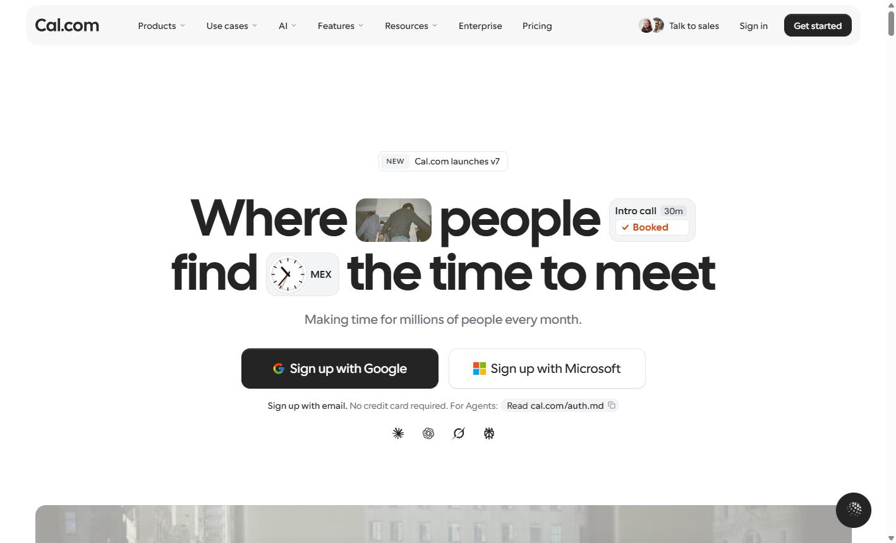

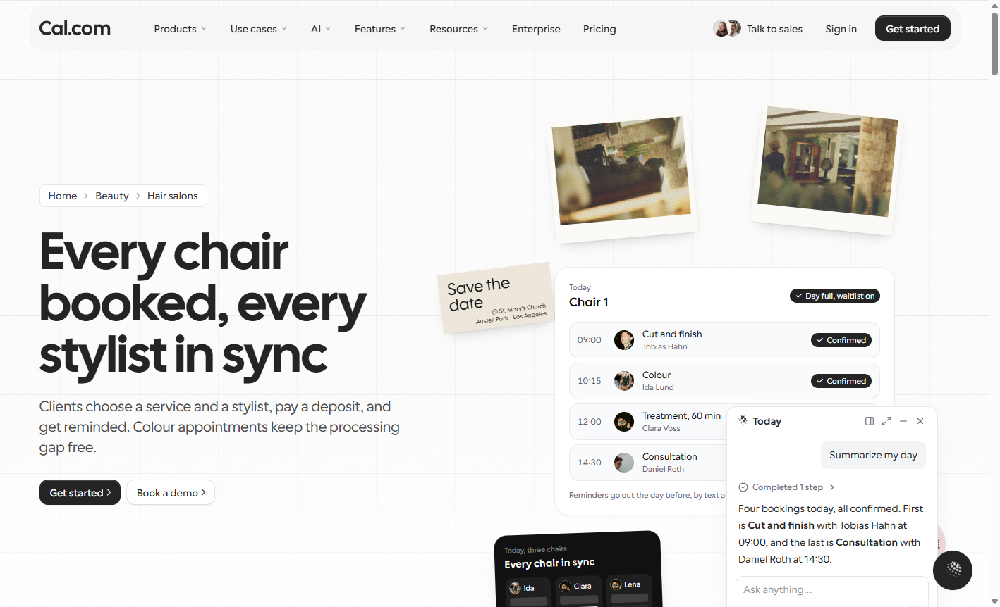

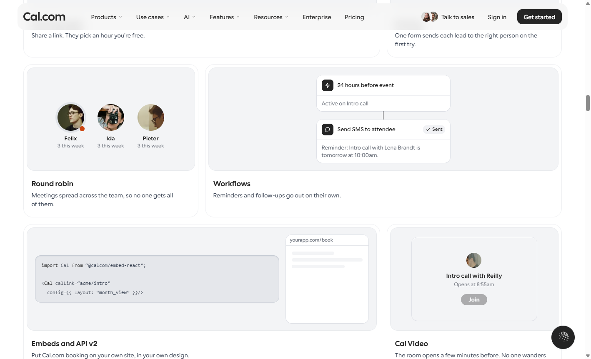

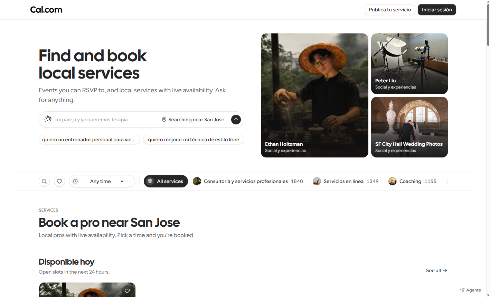

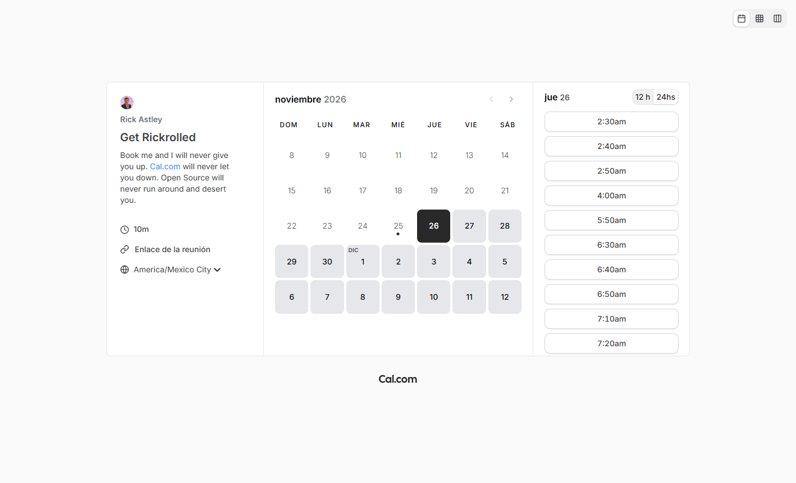

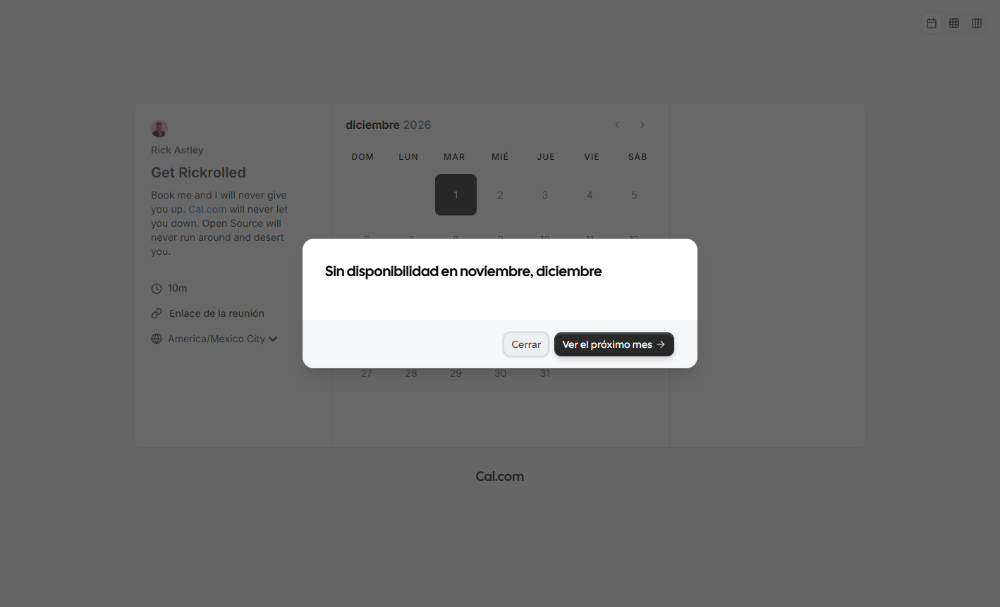

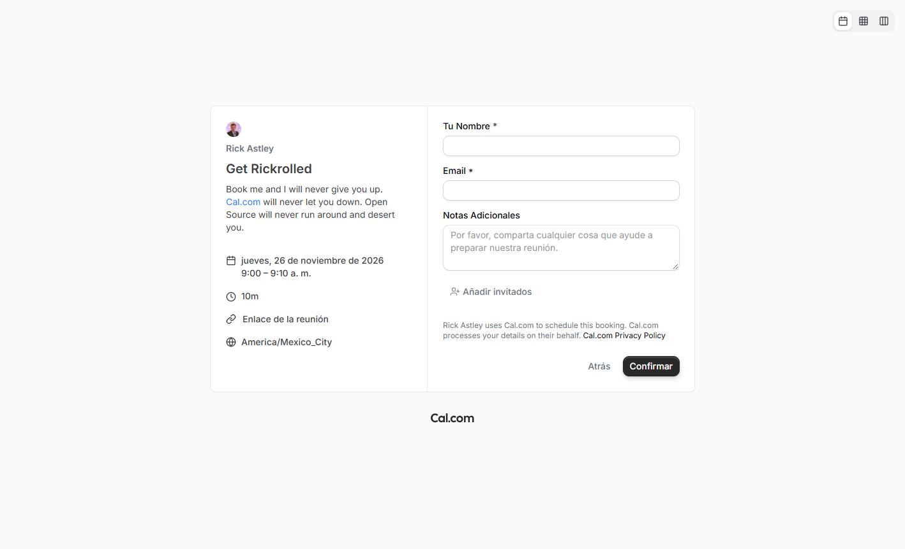

### 2.2 Aplicación Interna Autenticada (`https://app.cal.com` v7.0.5-h)

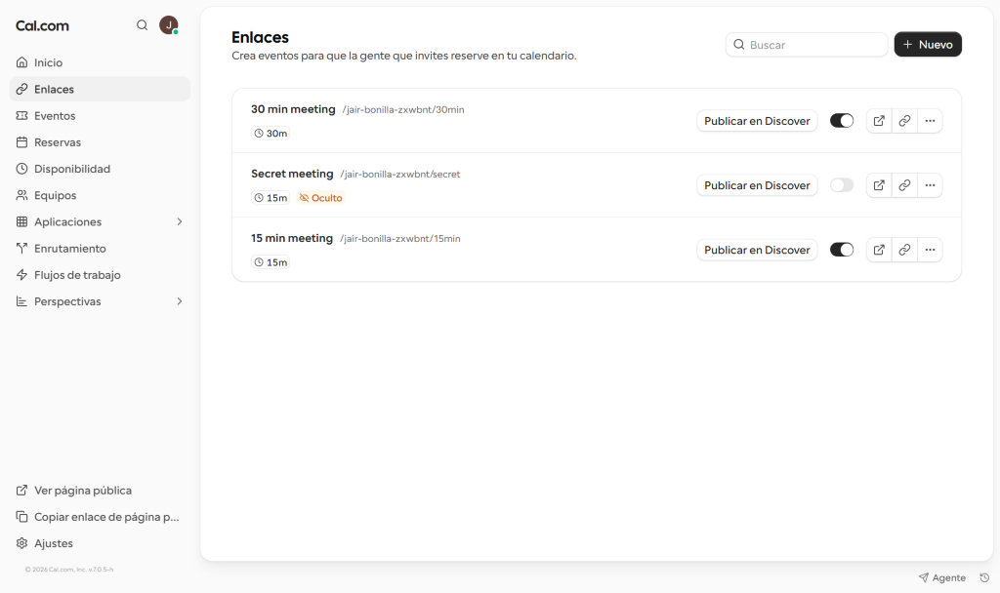

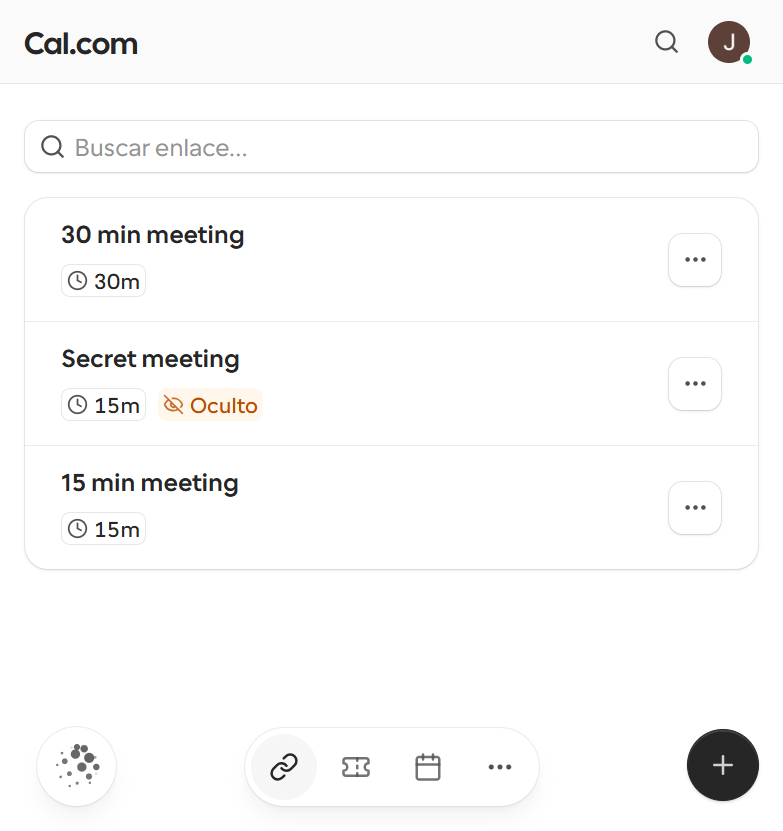

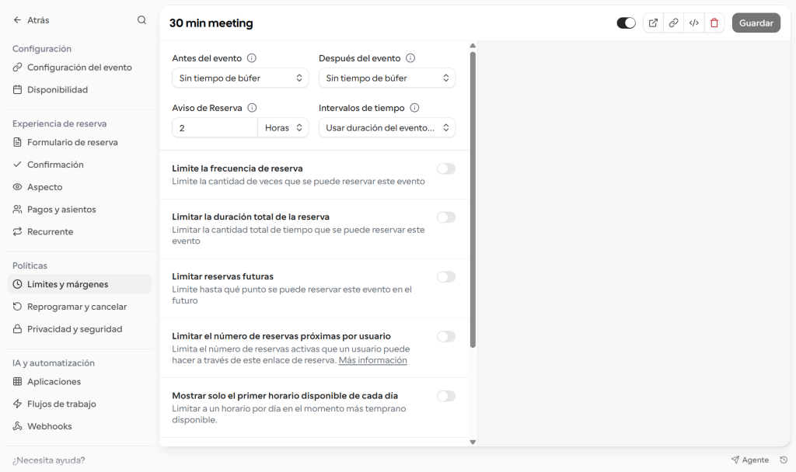

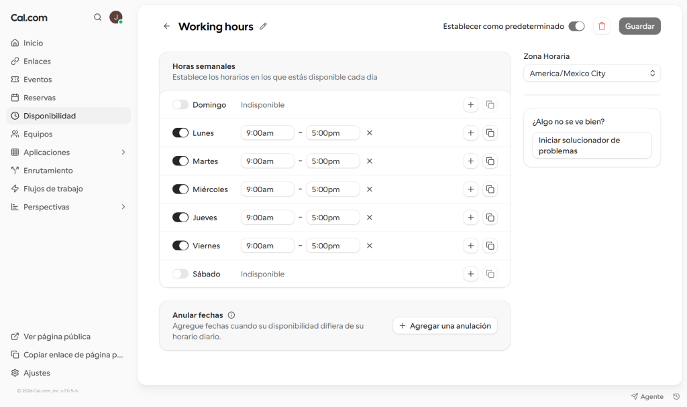

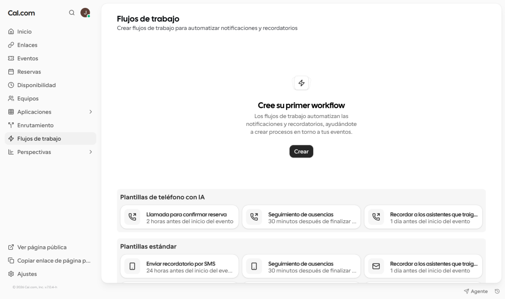

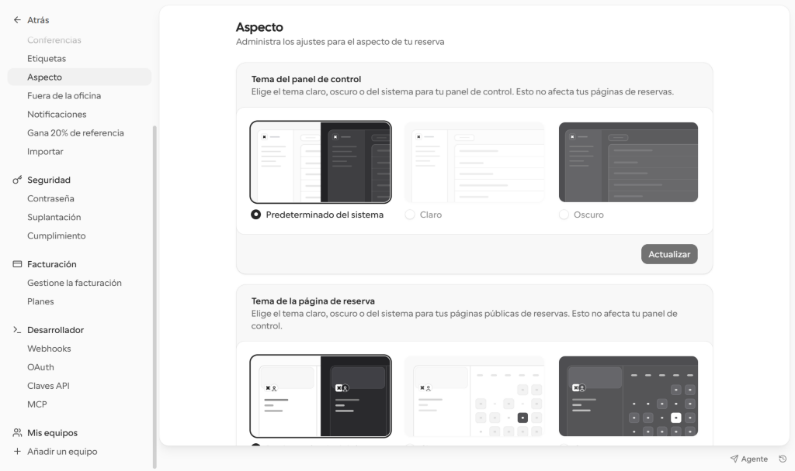

---

## 3. Anatomía del Sistema de Diseño y UX/UI de Cal.com v7 (Por qué se siente tan bien)

A partir de la extracción directa de `cal-app-2.css` (**807 tokens semánticos**) y los chunks de componentes, el secreto de la calidad visual de Cal.com no son animaciones pesadas ni gradientes llamativos, sino **6 decisiones estructurales ultra-disciplinadas**:

1. **Arquitectura de Superficies de 4 Niveles + Inset Canvas (`CardFrame`):**
   - Shell exterior y bandejas (`CardFrame`): `--cal-bg-muted: #f6f7f9`
   - Superficie principal y filas de datos: `--cal-bg: #ffffff` (flotando dentro del shell con radio `12px` y borde `1px solid #e5e7eb`)
   - Chips, hover y estado sutil: `--cal-bg-subtle: #eeeff2`
   - Énfasis y contraste máximo: `--cal-bg-emphasis: #e5e7eb` y `--cal-bg-inverted: #070a0d`
   - **Regla clave:** Los listados densos (`Enlaces`, `Horas semanales`, `Preguntas de reserva`) viven como **filas separadas por hairlines `#eeeff2` dentro de un único contenedor redondeado**, nunca como tarjetas independientes apiladas. *(Encaja 100% con la regla nativa de `@astryxdesign/core` en nuestro repo).*
2. **Micro-sombras táctiles por estado de interacción:**
   - En lugar de botones planos o sombras exageradas, Cal.com define tokens dedicados por estado (`--shadow-button-solid-brand-default | hover | active | focused`, `--shadow-outline-gray-rested | hover | active | focused`, `--shadow-switch-thumb`, `--shadow-dropdown`), logrando sensación física nítida con transiciones de `150ms cubic-bezier(.4,0,.2,1)`.
3. **Jerarquía tipográfica y `tabular-nums` obligatorio:**
   - Fuente geométrica (`Cal Sans` en headings + sans limpio en cuerpo), contraste de texto en 4 tonos (`#070a0d` → `#3c3e44` → `#6b7280` → `#9ca3b0`), y clase `tabular-nums` en horarios, contadores y precios para evitar saltos horizontales al cambiar de fecha o correr el temporizador.
4. **Revelación progresiva estricta (Zero Form Overwhelm):**
   - En el editor (`12-cal-auth-event-editor.png`), las reglas avanzadas (`Límites`, `Políticas`, `Privacidad`) aparecen colapsadas a **1 fila limpia** (`Título + descripción 1 línea + Switch`) y solo expanden sus inputs cuando se activan.
   - El botón `Guardar` permanece deshabilitado (`shouldDirty`) hasta que hay cambios reales.
5. **Wireframe Cards y Live Preview Contextual:**
   - En `Aspecto` (`15-cal-auth-appearance.png`), la selección de tema (`Sistema / Claro / Oscuro`) y de layout (`Mes / Semanal / Columna`) usa **miniaturas wireframe visuales** en vez de simples `<select>`, y verifica contraste WCAG automáticamente (`dark_theme_contrast_error` en `0hinjnnmyera0.js`).
   - En el Editor de Enlaces, el panel derecho muestra un **preview interactivo en vivo que cambia según la pestaña** (calendario en `setup/limits`, diálogo de cancelar/reprogramar en `reschedule`).
6. **Empty States accionables + Dock Móvil tipo Isla:**
   - Ningún empty state es una página muerta: `Flujos de trabajo` muestra inmediatamente la galería de 9 plantillas clicables debajo del CTA; el Booker sin disponibilidad dispara el diálogo `Sin disponibilidad → [Ver el próximo mes →]`; en móvil (`10b-cal-auth-links-mobile.png`) usa un **dock inferior flotante tipo isla** + FAB `+`.

---

## 4. Arquitectura Técnica y Mecánicas de Código Recuperadas (REA)

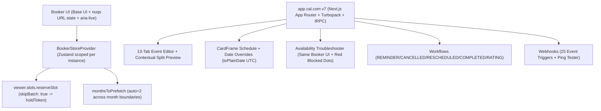

### Detalles de Implementación Extraídos del Código Guardado

1. **Estado del Booker y URLs compartibles (`3jpad8h6t9y56.js` + `nuqs`):**
   - `BookerStoreProvider` crea un store Zustand aislado en Context por cada instancia del widget (permite múltiples embeds sin colisión).
   - Máquina de estados explícita: `loading` → `selecting_date` → `selecting_time` → `booking`.
   - Sincronización bidireccional con query params vía `nuqs` (`?layout=month_view|week_view|column_view`, `?date=`, `?slot=`, `?month=`, `?overlayCalendar=true`) — sobrevive recargas y permite enlaces prefiltrados desde Instagram/WhatsApp.
   - Prefetch inteligente (`monthsToPrefetch`): detecta si la semana/columna visible cruza cambio de mes (`l !== n`) y precarga automáticamente 2 meses para cero parpadeo, renderizando el cambio de mes inline (`DIC 1`) en la cuadrícula.
2. **Apartado de Horario en Tiempo Real (`3myojl6v5ys5j.js`):**
   - `viewer.slots.reserveSlot.useMutation({ trpc: { context: { skipBatch: true } } })` evita latencia de batching; el servidor emite `{ reserverUid, holdToken, reservationId }` (refuerza exactamente el diseño propuesto en `super_mejoras.md S7`).
   - Libera el hold automáticamente con `viewer.slots.removeSelectedSlotMark` al volver atrás o desmontar.
3. **Accesibilidad de Clase Mundial (`12oifkt9kc3pu.js`, `1oyhw1v-zd98v.js`, `3myojl6v5ys5j.js`):**
   - Cada día y horario incluye `aria-label` localizado completo con zona horaria (`"jueves, 26 de noviembre de 2026, 9:00 a. m. (America/Mexico_City)"`).
   - Regiones `aria-live="polite" aria-atomic="true"` anuncian cambios de slots y estados de confirmación; modales aplican `inert` / `aria-hidden` sobre el fondo para trap de foco impecable.
4. **Excepciones de Fecha sin Bugs de Zona Horaria (`2x1z8kz-49vk3.js`):**
   - Usa `useFieldArray({ name: "dateOverrides" })` normalizando fechas con `toPlainDate(start, "UTC")` (evita el clásico bug de desfase de 1 día en horarios nocturnos MX) y archiva automáticamente excepciones pasadas.
5. **Features de Scheduling Avanzadas Detectadas en Código y UI:**
   - **`Franjas optimizadas` (`Optimized Slots`):** encaja los horarios disponibles pegados al fin real de citas existentes (ej. si una cita de 75 min acaba a las 10:15, ofrece 10:15 en lugar de saltar a las 11:00) — ideal para maximizar ocupación en salones de uñas.
   - **`Solucionador de problemas` visual (`/availability/troubleshoot`):** reutiliza el mismo Booker mostrando días bloqueados con borde rojo y **slots bloqueados con punto rojo** junto a los disponibles, explicando el motivo exacto (`Fuera del horario laboral`, `Aviso mínimo`, `Conflicto Google Calendar`).
   - **`maxActiveBookingPerBookerOfferReschedule`:** cuando una clienta alcanza el límite de citas activas, en vez de bloquearla en seco, le ofrece reprogramar su cita existente.
   - **`Solicitar reprogramación` + `reschedule-with-bypass-host-availability`:** la recepcionista puede pedirle a la clienta que elija nueva hora con 1 clic, o reprogramar una clienta VIP saltando el horario público.
   - **`Fuera de la oficina` + `Días festivos` por país + Redirección a compañera:** bloquea festivos oficiales de México, muestra nota pública en el widget y puede redirigir reservas a otra manicurista.
   - **Embed de 4 modos (`Insertar`) + `qr.cal.com`:** inline, botón flotante, clic en elemento e incrustado en correo electrónico, con personalizador de colores claro/oscuro en vivo.
   - **`Eventos` (`/events/new`):** constructor conversacional inline (*"Estoy organizando `[título]` el `[fecha]` hasta `[hora]` en `[lugar]`"* + `⌘↵`) para talleres o eventos especiales.
   - **Telemetría de fricción en tRPC (`viewer.insights.*`):** `cancellationAndRescheduleReasons`, `failedBookingsByField` *(detecta qué campo del formulario provoca abandonos)*, `bookingsByHourStats`, `csatOverTime`, `recentNoShowGuests`.

---

## 5. Blueprint de Adopción UX/UI y Scheduling para `nails` (En `@astryxdesign/core`)

> [!TIP]
> **Complementariedad perfecta con AgendaPro:** Mientras **AgendaPro** nos dio el blueprint de *operación de salón* (POS lateral, propinas, sellos, caja, CRM de retoques y PIN), **Cal.com v7** nos da el blueprint de **craft UX/UI, inteligencia de agenda y accesibilidad**, totalmente implementable con tokens y componentes de `@astryxdesign/core` respetando `AGENTS.md`.

### Prioridad P0 — Mejoras UX/UI y Motor de Alto Retorno Inmediato

| # | Patrón de Cal.com v7 | Cómo aplicarlo en `nails` (Astryx + Dominio Puro) | Sinergia `super_mejoras.md` |
| :--- | :--- | :--- | :--- |
| **C1** | **Franjas Optimizadas (`Optimized Slots`)** | Añadir modo opcional en `src/lib/availability/engine.ts` que genera candidatos de inicio anclados al `occupiedEndAt` de citas existentes (además del grid fijo), eliminando huecos muertos de 15–30 min tras servicios de 75–90 min (acrílico + nail art). | Potencia `D1`, `P1` |
| **C2** | **Accesibilidad Nivel Cal.com + URL State + Borde de Mes + Empty-State Recovery en `/reservar`** | En `BookingWidget.tsx`: (a) `aria-label` completo por día/horario + región `aria-live="polite"` para cambios de slots, hold de 3 min y colisiones `409`; (b) persistir `?servicio=&addons=&staff=&date=&layout=&slot=` en URL; (c) mostrar transición de cambio de mes inline (`DIC 1`) y diálogo automático **`Sin disponibilidad este mes → Ver próximo mes / Lista de espera`**; (d) `tabular-nums` en precios y reloj del hold. | Concreta `§6 UX/A11y` y `P2` |
| **C3** | **Solucionador Visual de Disponibilidad en `/admin/disponibilidad`** | Reemplazar la tabla de texto actual del Troubleshooter por el mismo componente de calendario/slots de `/reservar` en modo diagnóstico: días bloqueados clicables y **slots bloqueados marcados visualmente junto a los libres** explicando la causa exacta desde `assertSlotBookable` (horario, buffer, aviso mínimo, excepción, Google Calendar). | Cierra `D7` con UX 10× mejor |
| **C4** | **Shell Inset `CardFrame` + Revelación Progresiva + Acciones Segmentadas en `/admin/*`** | Adoptar la jerarquía visual de Cal.com dentro del tema Astryx: filas con divisores hairline dentro de contenedores agrupados en `/admin/servicios` y `/admin/disponibilidad`, grupo de botones segmentado `[Vista previa | Copiar link | ...]` por servicio, toggles de revelación progresiva en políticas de reserva, y botón `Guardar` deshabilitado cuando el formulario está limpio. | Alinea `F1`–`F5` y `AGENTS.md` |
| **C5** | **Bloqueo de Zona Horaria Presencial + Validador Automático de Contraste WCAG en `/admin/marca`** | (a) Fijar `America/Mexico_City` con indicador explícito *"Hora local del salón"* en `/reservar` para evitar errores de clientas con VPN/viaje; (b) en `/admin/marca`, añadir alerta automática de contraste WCAG (como `dark_theme_contrast_error`) y **wireframe cards visuales** para elegir tema (`Sistema / Claro / Oscuro`) y vista predeterminada (`Mes / Semana / Columnas`). | Eleva `U7` y `/admin/marca` |

### Prioridad P1 — Políticas Inteligentes y Experiencia de Clienta sin Fricción

| # | Patrón de Cal.com v7 | Cómo aplicarlo en `nails` |
| :--- | :--- | :--- |
| **C6** | **Límite de Citas Activas con Reprogramación Automática + `Solicitar reprogramación`** | Si una clienta ya tiene N citas activas, ofrecer automáticamente reprogramar su cita existente en vez de un error seco (`maxActiveBookingPerBookerOfferReschedule`). En `/admin/citas`, añadir botón **`Solicitar reprogramación`** que envía el link mágico `/cita/[token]?action=reschedule` por WhatsApp. |
| **C7** | **Festivos Oficiales de México + Vacaciones con Nota Pública y Redirección a Otra Manicurista** | En `/admin/disponibilidad`: precarga en 1 clic de días festivos MX, modal multi-fecha para excepciones (`toPlainDate` sin desfase UTC, auto-archivado al pasar la fecha), nota pública opcional en `/reservar` (*"Cerrado por puente"*) y redirección automática a otra manicurista cuando una está de vacaciones. |
| **C8** | **Motivos de Cancelación/Reprogramación + Plantillas de Workflows con Empty-State Accionable** | Hacer obligatorio (configurable) elegir motivo rápido al cancelar/reprogramar y graficarlo en reportes (`cancellationAndRescheduleReasons`), junto con la galería de plantillas de automatización en `/admin/integraciones` (incluyendo *Seguimiento de inasistencia 30 min después* y *Recordatorio "ven sin gel previo"*). |

### Prioridad P2 — Crecimiento y Ecosistema

| # | Patrón de Cal.com v7 | Cómo aplicarlo en `nails` |
| :--- | :--- | :--- |
| **C9** | **Embed de 3 Modos + Generador QR + Enlaces Privados VIP** | Modal `Insertar` en `/admin/marca` (Inline / Botón flotante / Popup al clic con preview en vivo) + descarga de QR para mostrador + **enlaces privados de un solo uso** para clientas VIP o servicios exclusivos ocultos del menú público (`Secret meeting`). |
| **C10** | **Telemetría de Abandono del Widget (`failedBookingsByField`) + Webhooks con Prueba Ping** | Medir qué paso o campo del widget provoca errores/abandonos y añadir panel de `Webhooks` con botón **`Prueba Ping`** para conectar fácilmente con n8n/Make/Zapier. |

---

## 6. Rutas del Archivo de Código Guardado (Para Consulta Técnica)

- **Evidencia REA consolidada (69 registros):** `../rea-evidence/rea_full_evidence_bundle.json.gz`
- **Booker en vivo (83 archivos JS + extractos):** `./code/booker_scripts/` y `./code/booker_mechanics_excerpts.txt`
- **Chunks autenticados de `app.cal.com` (33 archivos JS + análisis):** `./code/auth_chunks/` y `./code/auth_chunks_analysis.txt`
- **Sistema de diseño CSS completo (7 hojas, 807 tokens):** `./code/css/`
- **Landing v7 y Shell Login (189 archivos JS):** `./code/landing_scripts/` y `./code/app_login_scripts/`
- **17 páginas de documentación de features:** `./code/feature_pages/`
- **Copia portable del blueprint en el repo:** `docs/plan/calcom-ux-audit.md`
