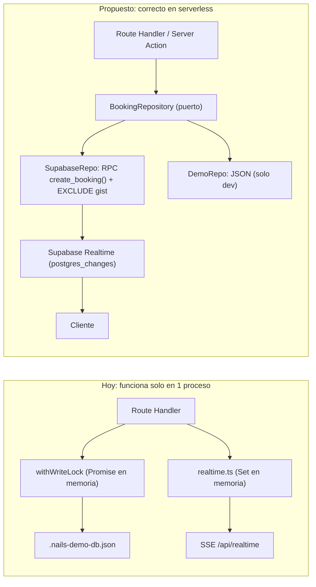
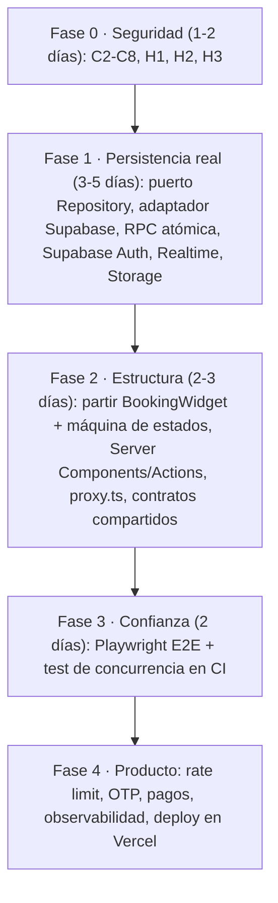

# Revisión de arquitectura — `nails`

**Base revisada:** commit `cc87c8b` · ~14.8k líneas · 35 rutas · `npm run verify` en verde.

> [!IMPORTANT]
> El harness (guardrails, tipos estrictos, property tests) es sólido. Los problemas de fondo están **fuera de lo que el harness mide**: la capa de persistencia real no existe, hay huecos de autenticación que llegarían a producción y la arquitectura "realtime + lock" solo funciona en un proceso local.

---

## 1. Hallazgos críticos (bloquean producción)

| # | Hallazgo | Evidencia | Impacto |
|---|---|---|---|
| C1 | **Supabase no está implementado.** `@supabase/*` no se importa en ningún archivo de `src/`; `knip.json` las ignora. Todo pasa por `.nails-demo-db.json`. | [db.ts](../../src/lib/repositories/db.ts#L45-L122), [knip.json](../../knip.json) | La promesa de "pega las credenciales en `.env` y funciona" **no se cumple**. En Vercel el FS es de solo lectura → las reservas se pierden. |
| C2 | **Escalada a admin con cookie falsificable.** La sesión es el correo en texto plano en la cookie `nails_admin_email`, sin firma, y se valida **antes** de revisar el modo Supabase. | [admin-session.ts](../../src/lib/auth/admin-session.ts#L12-L24) | Cualquiera que sepa el correo de la dueña obtiene rol `owner` con un `document.cookie`. |
| C3 | **Login sin contraseña + lista pública de admins.** `POST /api/admin/session` solo pide correo; `GET` devuelve `availableDemoUsers`. Sin Supabase, cualquiera entra como `owner` automáticamente. | [session/route.ts](../../src/app/api/admin/session/route.ts) | Aceptable en demo, fatal si se despliega sin `NEXT_PUBLIC_SUPABASE_URL`. No hay "fail closed". |
| C4 | **El webhook de WhatsApp se salta la firma** con el header `x-nails-demo-simulate: 1`, y `verifyMetaWebhookSignature` devuelve `true` si falta `WHATSAPP_APP_SECRET`. Token de verificación por defecto `nails-demo-verify`. | [webhooks/whatsapp/route.ts](../../src/app/api/webhooks/whatsapp/route.ts#L31-L35), [whatsapp-booking.ts](../../src/lib/integrations/whatsapp-booking.ts#L11-L16) | Cualquiera puede crear reservas o llenar la agenda vía webhook. |
| C5 | **El endpoint público de reservas acepta `forceConfirmed` y `source`.** | [bookings/route.ts](../../src/app/api/bookings/route.ts#L26-L27), [db.ts](../../src/lib/repositories/db.ts#L544-L547) | Una clienta puede saltarse el anticipo o la confirmación manual mandando `forceConfirmed: true`. |
| C6 | **IDOR en `PATCH /api/admin/bookings`.** Una `specialist` puede cambiar el estado o la propina de **cualquier** cita (solo el `GET` filtra por `staffId`). | [admin/bookings/route.ts](../../src/app/api/admin/bookings/route.ts#L36-L52) | Rompe el RBAC multi-admin que pediste. |
| C7 | **El callback OAuth de Google no tiene auth ni CSRF.** `state` = `staffId` en claro; no canjea `code`. | [google/callback/route.ts](../../src/app/api/integrations/google/callback/route.ts) | Cualquiera marca calendarios como conectados; no hay sync real. |
| C8 | **El cron de recordatorios es abierto** si falta `CRON_SECRET`, y **no persiste**: muta `getSnapshot()` fuera de `withWriteLock`. | [cron/reminders/route.ts](../../src/app/api/cron/reminders/route.ts#L13-L68) | Recordatorios duplicados en cada ejecución y SMS/WhatsApp con costo disparados por terceros. |

---

## 2. Arquitectura y concurrencia (anti-doble-booking)

| # | Problema | Propuesta |
|---|---|---|
| A1 | El mutex y el bus realtime viven en `globalThis` → en Vercel (varias instancias) **no hay exclusión mutua** ni eventos entre instancias. La garantía anti-doble-booking hoy depende de un solo proceso. | **Patrón puerto/adaptador:** interfaz `BookingRepository` en `src/lib/repositories/port.ts` con dos adaptadores (`demo/`, `supabase/`) elegidos por `env`. La atomicidad real queda en Postgres: función RPC `create_booking_atomic()` (`SECURITY DEFINER`) que valida el hold y hace `INSERT`; el `EXCLUDE USING gist` que ya existe en la migración es la última línea de defensa (`23P01` → 409 tipado). |
| A2 | `db.ts` (1,321 líneas) mezcla persistencia, reglas de negocio, notificaciones, Google sync y realtime (efectos secundarios **dentro** del lock). | Separar en **casos de uso** (`src/lib/use-cases/createBooking.ts`, etc.): validar → repo transaccional → emitir eventos **después** del commit (patrón outbox: tabla `outbox_events` procesada por cron). Así una caída de Resend no deja el lock abierto ni la reserva a medias. |
| A3 | `getSnapshot()` devuelve el objeto mutable cacheado; los lectores pueden mutarlo por accidente (el cron ya lo hace). | `getSnapshot()` → `Readonly<DeepReadonly<DemoDatabase>>` por tipo; todas las mutaciones solo pasan por `withWriteLock`. Agregar regla en `check-guardrails.mjs`: prohibido asignar propiedades sobre el resultado de `getSnapshot`. |
| A4 | El JSON se parsea con `as DemoDatabase` sin validar. | Esquema Zod `DemoDatabaseSchema` (y que los tipos salgan de `z.infer`, siguiendo *Foundational Thinking*). |
| A5 | Fotos de inspiración y comprobantes van como base64 de hasta **2.5 MB** dentro del JSON de la reserva. | Supabase Storage con URL firmada de subida; la reserva guarda solo la ruta. |
| A6 | `bookingCode = NL-` + 4 dígitos aleatorios → colisión probable (~50% con ~120 citas). | Secuencia en Postgres o código base32 de 6 caracteres con `UNIQUE` y reintento. |
| A7 | Los holds no se ligan a la reserva: `createBookingAtomic` no exige que exista un hold vigente del mismo `sessionToken`. | Exigir `holdId` + `sessionToken` en el contrato; property test: "nunca se confirma un slot cuyo hold pertenece a otra sesión". |

---

## 3. Estructura de código y frontend

| # | Problema | Propuesta |
|---|---|---|
| F1 | `BookingWidget.tsx` = **1,354 líneas**; `admin/citas/page.tsx` = 737. | Partirlo en `booking/` → `ServicePicker`, `AddonPicker`, `SlotCalendar`, `HoldTimer`, `ClientForm`, `Summary` + un reducer puro `bookingMachine.ts` (máquina de estados tipada: `browsing → holding → submitting → confirmed | conflict`) con property tests. Guardrail nuevo: **máx. 400 líneas por archivo** en `src/components` y `src/app`. |
| F2 | Las 11 páginas de admin son `'use client'` y hacen 35 `fetch('/api/...')` a mano. | Server Components para leer datos (sin waterfall ni spinners) + **Server Actions** para mutar, con los mismos esquemas Zod. Las rutas `/api` quedan solo para webhooks, ICS, CSV y clientes externos. |
| F3 | No hay `proxy.ts` (antes middleware); la protección de `/admin` ocurre en el cliente (`AdminProvider`). | `src/proxy.ts` que verifique la sesión y redirija a `/admin/login` antes de renderizar; RBAC por ruta usando `rbac.ts`. |
| F4 | Los contratos de API están duplicados (Zod en las rutas, tipos a mano en los componentes). | `src/lib/contracts/*.ts`: esquemas Zod compartidos (request y response) importados por la ruta y por el cliente. |
| F5 | `next.config.ts` sin cabeceras de seguridad; `images.unoptimized: true`. | CSP, `X-Frame-Options`, `Referrer-Policy`, `Permissions-Policy`; activar `next/image` para la galería (LCP). |

---

## 4. Huecos del harness (Error-Driven System Hardening)

| # | Hueco detectado | Endurecimiento propuesto |
|---|---|---|
| H1 | **Un comentario se coló:** `// Stream closed` dentro de un `catch {}` vacío en [realtime/route.ts](../../src/app/api/realtime/route.ts#L17-L19). El escáner de comentarios "leading/trailing" no ve comentarios colgantes en bloques vacíos. | Escanear **todo el texto fuente** con `ts.createScanner` (`skipTrivia: false`, con re-scan de templates) en lugar de los rangos por nodo + fixture de prueba para el propio guardrail. |
| H2 | Los huecos de seguridad (C2–C8) no los detecta ningún check. | Reglas AST nuevas: (a) toda ruta en `src/app/api/admin/**` debe llamar `requireAdmin`; (b) prohibido leer headers `x-*-demo-*` y valores por defecto `\|\| '...'` para secretos en `process.env`; (c) los esquemas de las rutas públicas no pueden tener campos `force*`, `source` ni `role`. |
| H3 | No hay CI: `verify` solo corre en local. | GitHub Actions `verify.yml` en cada PR + rama `main` protegida. |
| H4 | No hay E2E; la verificación en navegador es manual. | Playwright guiado por `docs/feature-map.md`: reserva feliz, **dos navegadores compitiendo por el mismo slot (espera 1 éxito + 1 409)**, expiración de hold, cancelación fuera de ventana, RBAC de specialist. Agregarlo a `verify`. |
| H5 | No hay tests de las rutas HTTP. | Tests de route handlers con `Request` real (Zod 400, 401/403 por rol, 409). |
| H6 | `fast-check` cubre el motor, pero no la concurrencia. | Property test con `fc.scheduler()` disparando N `createBookingAtomic` concurrentes al mismo slot → exactamente 1 éxito. |

---

## 5. Producto y operación

- **Rate limiting** en `/api/bookings`, `/api/slot-holds`, `/api/coupons/validate` y `/api/waitlist` (Upstash o una tabla de Postgres) — hoy se puede apartar toda la agenda con un script de holds.
- **Anti-spam** en reservas: verificación por OTP de WhatsApp/SMS para clientas nuevas (también sirve para "mis citas" sin token).
- **Observabilidad:** logger estructurado + Sentry; hoy los `catch {}` tragan errores (Resend o Google fallan en silencio).
- **Config del salón como datos, no código:** mover nombre, textos del landing, servicios y políticas a `salon_settings` + `/admin/marca` (ya hay base) para adaptar al cliente sin desplegar.
- **i18n/zonas horarias:** el motor usa `settings.timezone` (bien); falta un property test con fechas de cambio de horario (por si el cliente opera en EE.UU. o en una zona con DST).
- **Pagos reales:** `payments.ts` está en stub; conectar el webhook de Stripe o Mercado Pago → `pending_payment → confirmed` (idempotente).

---

## 6. Roadmap propuesto

> [!TIP]
> Recomiendo empezar por **Fase 0**: son cambios pequeños, cierran agujeros reales y cada uno se convierte en una regla de guardrail para que no vuelva a pasar.
