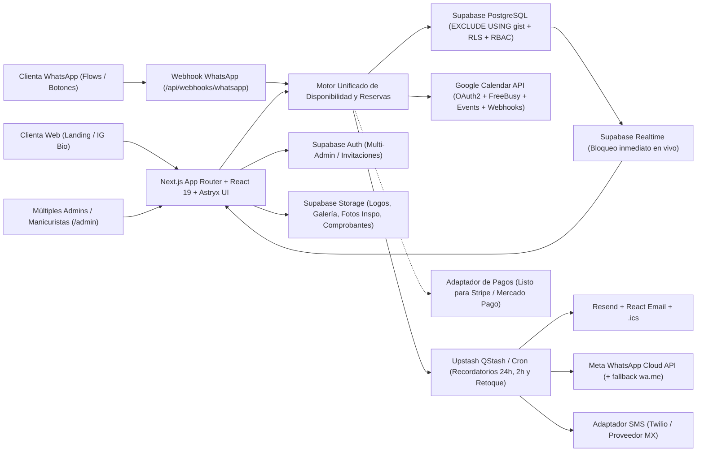

# Plan de Arquitectura e Implementación — Plataforma **Nails**

Plataforma web brandeada y sistema de citas en tiempo real para salones de uñas, construida **100% con `@astryxdesign/core`**, inspirada en **Cal.com v7** y diseñada para operar desde el día 1 en **modo demo funcional local** y pasar a producción simplemente pegando las credenciales en `.env`.

---

## 1. Decisiones Confirmadas

| Dimensión | Decisión acordada |
| :--- | :--- |
| **Nombre inicial y enfoque** | **Nails** (single-tenant, 1 deploy altamente personalizable para este cliente; listo para adaptar marca, textos, tema y secciones en cuanto haya detalles finales del salón). |
| **Modo Demo + Producción** | Todo funciona de inmediato en **modo demo interactivo** (con persistencia local/simulación completa) y trae migraciones SQL + adaptadores reales listos para activar al pegar variables en `.env`. |
| **Múltiples Admins y Equipo** | Múltiples personas pueden acceder a `/admin` con roles diferenciados (**Dueña / Owner**, **Admin / Recepción** y **Manicurista / Especialista**). Si solo hay 1 manicurista activa, el sitio público oculta el paso de elegir especialista. |
| **Estética base (Astryx)** | Híbrido **Boutique Editorial + Minimalista Neutro tipo Cal.com**: layout nítido de alto contraste con tonos cálidos/neutros, modo Light/Dark y personalización en vivo vía tema de Astryx. |
| **Catálogo y reserva** | **Servicios + Extras (add-ons)** que suman duración y precio automáticamente + subida opcional de **foto de referencia (*inspo*)**. |
| **Concurrencia en tiempo real** | Bloqueo instantáneo al agendar + **defensa anti-colisión de 3 capas** (Tiempo real + Constraint atómico en PostgreSQL + Recuperación elegante en UI sin perder datos). |
| **Gestión para la clienta** | **Sin registro ni contraseña:** link mágico único (`/cita/[token]`) para ver detalles, agregar a Google/Apple/Outlook/`.ics`, reagendar o cancelar (con regla de anticipación mínima). |
| **Canales de notificación** | **Correo (Resend + `.ics`)** + **WhatsApp (Meta Cloud API + respaldo `wa.me`)** + **SMS opcional (Twilio / adaptador configurable)** para confirmaciones y recordatorios. |
| **Booking por WhatsApp** | Integrado sobre el **mismo motor de disponibilidad y BD** (WhatsApp Flows / menús interactivos vía webhook): lo que se agenda por WhatsApp bloquea la web al instante y aparece en `/admin` y Google Calendar. |
| **Anticipos / Pagos** | En v1: confirmación automática o manual con comprobante de transferencia SPEI (por servicio). **Arquitectura preparada desde el día 1** (`PaymentProvider` + tabla `booking_payments`) para enchufar **Stripe o Mercado Pago** sin refactorizar. |

---

## 2. Patrones Clave Rescatados de Cal.com v7 (Auditados en Vivo)

1. **Reserva en 1 pantalla (3 columnas) + 3 vistas:** servicio/extras a la izquierda, calendario mensual al centro y horarios disponibles a la derecha con toggle `12h | 24h` y punto verde en tiempo real — más vistas **Mes / Semana / Columnas** y zona horaria bloqueable a `America/Mexico_City`.
2. **Editor con preview en vivo:** al editar un servicio o la marca/tema del salón, un panel lateral muestra en tiempo real cómo se ve para la clienta.
3. **Disponibilidad profesional:** horarios semanales con **tramos partidos** (ej. `10:00–14:00` y `15:00–19:00` para comida), copiar horarios entre días, **Excepciones por fecha** (*Date Overrides* que se auto-archivan), *buffers* antes/después (limpieza/esterilización) y **Diagnóstico de disponibilidad** (*"¿Por qué no aparece esta hora?"*).
4. **Google Calendar bidireccional claro:** separación entre *"Agregar eventos a"* (calendario destino) y *"Revisar conflictos en"* (toggles por sub-calendario personal/trabajo).
5. **Confirmación post-reserva completa:** resumen claro (*Qué, Cuándo, Con quién, Dónde*), botones **Agregar a Google / Apple / Outlook / `.ics`**, **Reagendar / Cancelar**, y acceso directo a WhatsApp.
6. **Workflows de recordatorios listos:** Confirmación inmediata, Recordatorio 24h, Recordatorio 2h, Cancelación/Reagendado y **Recordatorio de retoque (15–21 días)**, con canales configurables (Correo, WhatsApp, SMS).

---

## 3. Arquitectura Técnica y Stack



### Arquitectura Plug-and-Play (Demo Local → Producción con `.env`)
Toda la capa de datos e integraciones vive detrás de interfaces limpias (`src/lib/repositories/` y `src/lib/integrations/`):
- **Sin credenciales en `.env` (Modo Demo):** usa un repositorio local persistente en archivo JSON (`.nails-demo-db.json`, con lock atómico en servidor y stream SSE en vivo para simular Supabase Realtime entre pestañas), un simulador de logs de Email/WhatsApp/SMS/Google Calendar visible en `/admin/integraciones`, y acceso demo rápido a `/admin` con cambio de rol (`Owner` / `Admin` / `Manicurista`) para probar permisos.
- **Al pegar credenciales en `.env` (Producción):** cambia automáticamente a **Supabase** (Postgres + Auth + Realtime + Storage), **Google Calendar API**, **Resend**, **Meta WhatsApp Cloud API** y **Twilio SMS** sin modificar componentes ni flujos.

---

## 4. Defensa Anti-Colisión de 3 Capas (Cero Doble Booking)

Para garantizar que **nunca** dos personas reserven el mismo horario aunque presionen "Confirmar" en el mismo milisegundo (sea desde la web, desde `/admin` o desde WhatsApp):

### Capa 1 — Sincronización en Tiempo Real + Bloqueo Temporal (*Slot Hold*, opcional)
- La pantalla de reserva escucha cambios en vivo (**Supabase Realtime** en producción / **SSE** en modo demo). En cuanto un horario se confirma (desde otra pestaña, admin o WhatsApp), desaparece inmediatamente en pantalla sin recargar.
- Si se activa el **Slot Hold temporal** (**3 minutos**, configurable en `/admin/marca`, tabla `slot_holds` con `expires_at` y `session_token`), al elegir hora y pasar al formulario el slot queda reservado suavemente para esa clienta con un contador regresivo discreto y se libera automáticamente si abandona o expira.

### Capa 2 — Barrera Atómica a Nivel de Base de Datos + Idempotencia
- PostgreSQL impone un **Exclusion Constraint** con `btree_gist` sobre el rango de tiempo ocupado (incluyendo *buffers* de limpieza):

```sql
CREATE EXTENSION IF NOT EXISTS btree_gist;

ALTER TABLE bookings
  ADD CONSTRAINT no_overlapping_active_bookings
  EXCLUDE USING gist (
    staff_id WITH =,
    occupied_range WITH &&
  )
  WHERE (status IN ('pending_payment', 'pending_confirmation', 'confirmed'));
```

- **Clave de idempotencia (`Idempotency-Key`):** cada intento de reserva envía un UUID único desde el cliente; si una clienta con mala señal da doble clic en "Confirmar", el servidor devuelve la misma reserva creada en lugar de duplicarla o arrojar error.
- **Re-verificación fresca de Google Calendar:** justo antes del `INSERT` atómico, se valida que tampoco haya aparecido un evento nuevo en Google Calendar en los últimos segundos.

### Capa 3 — Manejo Elegante de Errores y Recuperación en 1 Clic (`409 SLOT_TAKEN`)
- Si dos clientas confirman el mismo horario exacto al mismo instante, **1 transacción gana** y la otra captura el código de Postgres `23P01` (`exclusion_violation`).
- La API responde `HTTP 409` con `{ code: "SLOT_TAKEN", suggestedSlots: [...] }` devolviendo los **3 horarios libres más cercanos** (del mismo día o día siguiente).
- En la UI de Astryx, la clienta **NO pierde su nombre, teléfono, extras ni foto *inspo* ya cargada**: ve un `Banner` claro (*"Ese horario acaba de ser tomado hace unos segundos — elige uno de los horarios disponibles más cercanos"*) con 3 chips seleccionables para confirmar en 1 solo clic.

---

## 5. Booking Integrado por WhatsApp (Sincronizado en Vivo)

El booking por WhatsApp usa **exactamente el mismo motor de disponibilidad y la misma función `createBooking()`** que la web:

1. **Webhook oficial de Meta (`/api/webhooks/whatsapp`):** recibe mensajes entrantes de clientas (con verificación de firma `X-Hub-Signature-256`).
2. **Flujo nativo dentro de WhatsApp:**
   - **WhatsApp Flows (recomendado):** pantallas nativas dentro del chat (1. Servicio y extras → 2. Especialista si >1 → 3. Fecha y horario consultados en tiempo real a nuestro endpoint → 4. Confirmación).
   - **Mensajes interactivos (fallback/complemento):** listas y botones nativos de WhatsApp (y opción de abrir el link web prellenado si quiere subir foto *inspo* o ver la galería).
3. **Sincronización instantánea bidireccional:**
   - Al confirmar por WhatsApp → ejecuta `createBooking()` con la misma restricción `EXCLUDE USING gist` → emite evento Realtime (el horario desaparece de la web en <1 segundo) → aparece en `/admin/citas` con etiqueta `WhatsApp` → se crea en Google Calendar → envía confirmación con link mágico `/cita/[token]` y programa recordatorios.
4. **Simulador incluido en Demo:** en `/admin/integraciones`, un panel de prueba permite simular una reserva entrante por WhatsApp y ver cómo desaparece el horario de la web y aparece en `/admin/citas` al instante.

---

## 6. Múltiples Administradores y Control de Roles (RBAC)

Soporte nativo para varias personas gestionando el negocio desde `/admin`:

| Rol | Permisos en `/admin` |
| :--- | :--- |
| **`owner` (Dueña)** | Control total: citas, servicios, disponibilidad, equipo, invitar/revocar admins, personalización de marca/landing, integraciones, pagos y reportes. |
| **`admin` (Co-admin / Recepción)** | Gestiona todas las citas (incluyendo altas manuales/walk-in y confirmación de anticipos), clientas, servicios, horarios del equipo y galería. No puede eliminar a la dueña ni alterar llaves de pagos/integraciones críticas. |
| **`specialist` (Manicurista)** | Ve y gestiona únicamente sus propias citas, su disponibilidad/excepciones y su conexión de Google Calendar. |

- **Invitaciones:** desde `/admin/equipo`, la dueña agrega correos y asigna rol (`admin_invitations` + Supabase Auth invite link / magic link).
- **Seguridad en BD:** políticas RLS de Supabase + verificación de rol en cada Server Action / API Route.

---

## 7. Diseño del Sistema de Temas en Astryx

1. **Tema base `nails`:** creado con `npx astryx experimental theme editor new nails --like neutral`, ajustando paleta cálida neutra editorial (claro y oscuro), tipografía limpia y radios elegantes; verificado visualmente con `npx astryx experimental theme editor show nails --png` y cableado con `npx astryx theme add nails`.
2. **Personalización dinámica del salón:** desde `/admin/marca`, el cliente ajusta nombre, logo, color de acento (light/dark), radios, modo por defecto, textos del landing, galería, ubicación, redes y políticas. Se aplica extendiendo el tema base con `defineTheme({ extends: nailsTheme, ... })` dentro de `<Theme>` (temas independientes para el sitio público y el panel `/admin`, sin `:root` overrides ni CSS crudo).
3. **Calidad Astryx verificada:** 100% componentes atómicos de `@astryxdesign/core`, cero `<div>`/`<span>` crudos, cero `#hex`/`px` hardcodeados, validado con `npx astryx doctor --built`.

---

## 8. Modelo de Base de Datos (Supabase PostgreSQL)

Tablas principales (en `supabase/migrations/`):
1. **`salon_settings`** (identidad, branding/tema, textos de landing, dirección/Maps, IG/WhatsApp, zona horaria, políticas, modo de anticipo/pagos, flags de slot-hold e integraciones).
2. **`admin_users`** (`auth_user_id`, `email`, `full_name`, `role`: `owner` | `admin` | `specialist`, `staff_member_id`, `is_active`, `invited_by`, `created_at`).
3. **`staff_members`** (manicuristas activas, bio, avatar, slug, orden).
4. **`service_categories`**, **`services`**, **`service_addons`**, **`staff_services`** (duración, precio, buffers antes/después, anticipo/confirmación manual, foto *inspo*, orden).
5. **`availability_schedules`**, **`availability_rules`** (tramos partidos), **`date_overrides`** (vacaciones/excepciones).
6. **`calendar_connections`** (Google Calendar OAuth cifrado por especialista, calendario destino, `conflict_calendar_ids[]`, webhook watch channel).
7. **`clients`** (directorio automático, teléfono E.164, correo, notas técnicas de uña/alergias/colores, historial de visitas y no-shows).
8. **`slot_holds`** (`staff_id`, `held_range`, `session_token`, `expires_at` — bloqueos temporales opcionales auto-expirables).
9. **`bookings`** (`booking_code`, `manage_token`, `service_id`, `staff_id`, `client_id`, `start_at`, `end_at`, `occupied_range` + **`EXCLUDE USING gist`**, `idempotency_key` UNIQUE, `status`, `source`: `web` | `whatsapp` | `manual` | `walk_in`, `inspo_photo_url`, `payment_proof_url`, `google_event_id`, `rescheduled_from_id`, `cancellation_reason`), **`booking_addons`**, **`booking_payments`** (listo para `manual_transfer` | `stripe` | `mercadopago`).
10. **`notification_workflows`**, **`scheduled_notifications`** y **`notification_logs`** (canales `email` | `whatsapp` | `sms`, tiempos relativos 24h/2h/retoque, estado e historial auditable).
11. **`whatsapp_sessions`** (estado efímero de conversaciones/flows de booking por WhatsApp).
12. **`gallery_items`** (portafolio de trabajos del salón vinculado a servicios).

---

## 9. Mapa de Rutas y Pantallas

### Sitio Público
- **`/` — Landing Brandeada:** Hero editorial customizable, servicios destacados con precio/duración y reserva directa, galería de diseños (*"Quiero este estilo"*), políticas claras, mapa/horarios y contacto directo.
- **`/reservar` y `/reservar/[serviceSlug]` — Agenda en Tiempo Real (estilo Cal.com):** selección de servicio + extras (actualiza tiempo y total al vuelo) → especialista (solo si >1) → widget 3 columnas (`Calendar` + slots `12h/24h` + vistas **Mes / Semana / Columnas**) con bloqueo en vivo → datos + foto *inspo* + comprobante opcional + manejo elegante de colisiones `409`.
- **`/cita/[token]` — Gestión sin cuenta:** estado, resumen, mapa, botones **Google / Apple / Outlook / `.ics`**, botón `wa.me`, **Reagendar** y **Cancelar**.

### Panel Admin (`/admin` — Multi-Admin con RBAC)
- **`/admin/login`** — Acceso seguro (Supabase Auth + selector de rol demo cuando corre sin `.env`).
- **`/admin`** — Resumen del día, alertas por confirmar, ocupación y link público copiable.
- **`/admin/citas`** — Tabs (`Próximas`, `Por confirmar`, `Pasadas`, `Canceladas`), filtros (incluyendo origen `Web` / `WhatsApp` / `Manual`), toggle **Lista / Calendario**, **`+ Nueva cita manual`**, confirmar/reagendar/no-show/cancelar.
- **`/admin/servicios`** — CRUD de servicios y extras con **preview en vivo**, buffers, orden y link copiable.
- **`/admin/disponibilidad`** — Horarios semanales con tramos partidos, copiar a otros días, modal de **Excepciones por fecha** y **Diagnóstico de horarios**.
- **`/admin/equipo`** — Gestión de manicuristas + **administradores con roles e invitaciones** + conexión Google Calendar.
- **`/admin/clientas`** — Directorio automático, historial, fotos *inspo* y notas técnicas.
- **`/admin/marca`** — Editor con **preview en vivo**: nombre, logo, colores/tema Astryx, textos de landing, galería, políticas y datos de anticipo/pagos.
- **`/admin/integraciones`** — Google Calendar (destino + conflictos), Resend Email, Meta WhatsApp Cloud API (notificaciones + **Booking por WhatsApp** + simulador demo), **SMS (Twilio / adaptador MX)**, Workflows de recordatorios (24h/2h/retoque) y conector preparado de Pagos (Stripe / Mercado Pago).

---

## 10. Plan de Ejecución por Fases

1. **Fase 1 — Fundación, Tema Astryx y Esquema de Datos:** Setup Next.js App Router + React 19 + TS + Astryx, creación y verificación visual (`--png`) del tema `nails`, migraciones SQL completas (incluyendo `EXCLUDE USING gist`, `slot_holds`, `admin_users` RBAC y RLS), `.env.example` documentado y capa dual (Demo persistente local + Supabase).
2. **Fase 2 — Motor de Disponibilidad, Anti-Colisión y Sitio Público:** Motor puro de disponibilidad + pruebas unitarias (extras, buffers, split-shifts, overrides, concurrencia y `.ics`), APIs de reserva con idempotencia y recuperación `409 SLOT_TAKEN`, stream Realtime/SSE, Landing brandeada `/`, flujo `/reservar` (3 vistas) y gestión `/cita/[token]`.
3. **Fase 3 — Panel Admin Multi-Usuario Completo:** Layout `shell-side-nav` con RBAC (`owner` / `admin` / `specialist`) y las 8 secciones con previews en vivo en Servicios y Marca.
4. **Fase 4 — Integraciones Reales + Booking por WhatsApp + SMS:** Google Calendar bidireccional (OAuth2 + FreeBusy + Events + Webhooks), Resend + `.ics`, Meta WhatsApp Cloud API (notificaciones + webhook/Flows de booking en vivo + fallback `wa.me` + simulador demo), adaptador SMS, cola de recordatorios (QStash/Cron) y adaptador de pagos listo para Stripe/Mercado Pago.
5. **Fase 5 — Verificación Integral y Entrega:** `npx astryx doctor --built`, tests unitarios, build de producción, pruebas E2E en navegador (móvil + escritorio, incluyendo prueba de concurrencia entre dos sesiones reservando el mismo horario) y guía de deploy + activación de `.env`.

---

## 11. Costos Operativos Reales (Referencia para tu Cotización)

| Servicio | Costo mensual estimado (1 salón) | Notas |
| :--- | :--- | :--- |
| **Vercel (Hosting)** | \$0 MXN (Hobby) | Dominio propio con HTTPS incluido. |
| **Supabase (BD + Auth + Storage + Realtime)** | \$0 MXN (Free tier) | 500 MB BD y 1 GB Storage; sobrado para 1 salón. |
| **Google Calendar API** | \$0 MXN | Cuota gratuita altísima. |
| **Resend (Correos)** | \$0 MXN | Hasta 3,000 correos/mes gratis. |
| **Upstash QStash / Cron** | \$0 MXN | Free tier cubre recordatorios diarios. |
| **Meta WhatsApp Cloud API (Recordatorios + Booking)** | ~\$80 – \$160 MXN/mes | Primeros 1,000 mensajes de servicio/mes gratis (booking iniciado por clienta); mensajes *Utility* (recordatorios) ~**\$0.16 MXN** c/u. |
| **SMS (Opcional — Twilio / Proveedor MX)** | ~\$3.30 MXN / SMS (Twilio) | ~20x más caro que WhatsApp en México; ideal dejarlo opcional solo como respaldo o para clientas sin WhatsApp. |
| **Dominio propio (`.com` / `.mx`)** | ~\$250 – \$450 MXN/año | Registro anual directo. |
| **TOTAL OPERATIVO BASE (sin SMS masivo)** | **~\$1,200 – \$2,400 MXN/año** | *(Vs. ~\$10,000 MXN/año de plataformas genéricas sin sitio web propio).* |
