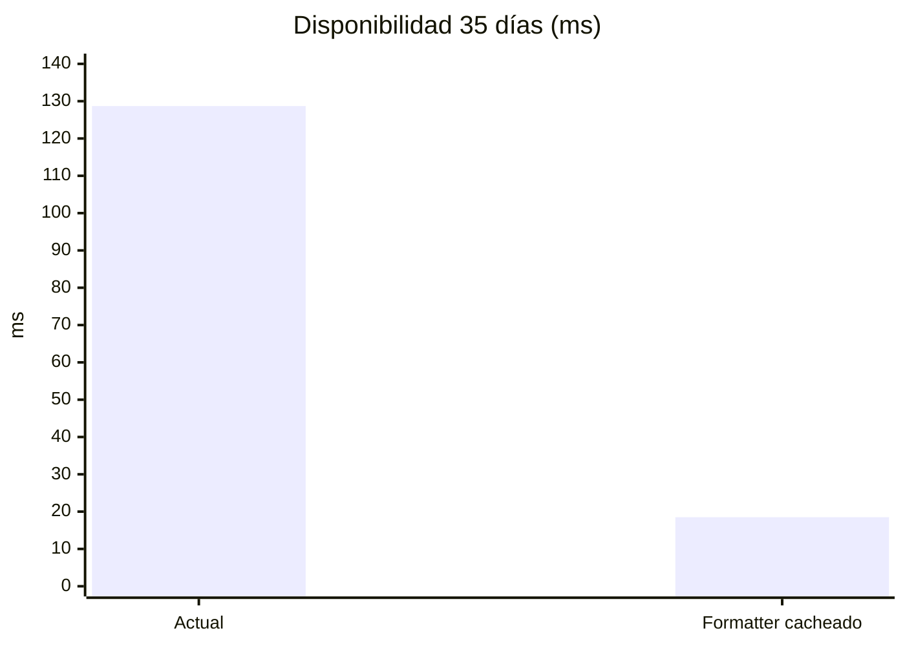
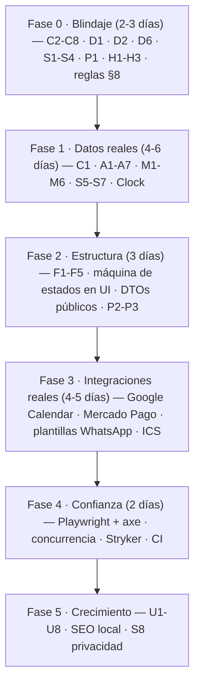

# Super mejoras — `nails`

> Este documento **complementa** a [architecture_review.md](./architecture_review.md) (C1–C8, A1–A7, F1–F5, H1–H6). Aquí solo aparece lo **nuevo** que salió de una segunda pasada más profunda: lectura completa del motor, del repositorio, del SQL y de las rutas, más un benchmark real.

**Base:** commit `cc87c8b` · demo DB actual · Node 24.22.

---

## 0. Las 10 super mejoras de mayor retorno

| # | Mejora | Por qué | Esfuerzo |
|---|---|---|---|
| 1 | **El servidor debe revalidar cada slot con el motor** antes de crear la cita, el hold o la reprogramación | Hoy se puede reservar a las 3 a. m., en el pasado o en vacaciones llamando directo a la API (D1) | S |
| 2 | **Máquina de estados de la cita** (transiciones permitidas y tipadas) | Una cita cancelada puede volver a `confirmed` encima de otra cita (D2) | S |
| 3 | **DTOs públicos** separados de las entidades internas | El HTML público incluye la comisión de cada especialista; el endpoint `diagnose` filtra códigos de cita y motivos de vacaciones (S3, S4) | S |
| 4 | **Cachear `Intl.DateTimeFormat`** en el motor | **Medido: 129 ms → 18 ms (7×)** por consulta de disponibilidad (P1) | XS |
| 5 | **Escapar HTML en correos y CSV** | Inyección de HTML en correos enviados con tu dominio; el CSV de caja se rompe con comas y permite fórmulas (S1, S2) | XS |
| 6 | **Reloj inyectado (`Clock`)** en lugar de `Date.now()` en repos e integraciones | Hay 24 llamadas a `Date.now()`/`Math.random()`; sin reloj inyectado los tests de tiempo no son deterministas (G2) | S |
| 7 | **Un solo origen de verdad para esquema, tipos y seed** | `types.ts` escrito a mano no coincide con el SQL; `demo-seed.ts` (929 líneas) y `seed.sql` (44) divergen (M1–M3) | M |
| 8 | **Realtime sin PII**: canal público de "intervalos ocupados" | Con RLS, la clienta anónima **no recibe** cambios de `bookings`, así que el tiempo real no funcionaría con Supabase (S6) | M |
| 9 | **Citas recurrentes ("relleno cada 3 semanas")** + política automática de no-shows | Son las dos funciones que más ingreso retienen en un salón de uñas (U1, U2) | M |
| 10 | **Nuevas reglas de guardrail** derivadas de estos bugs | Para que ninguna de estas clases de error vuelva a aparecer (G1) | S |

Esfuerzo: XS < 1 h · S ≈ medio día · M ≈ 1–3 días · L > 3 días.

---

## 1. Bugs de dominio (correctitud)

### D1 — El servidor confía en el `startAt` del cliente
[`createBookingAtomic`](../../src/lib/repositories/db.ts#L438-L504) solo revisa traslapes (citas, holds, Google). **No valida**: horario laboral, excepciones de fecha o vacaciones, aviso mínimo, `maxBookingDaysAhead`, alineación al intervalo ni que la fecha sea futura. Lo mismo pasa en `createOrRefreshSlotHold` y en la reprogramación.

**Propuesta:** un único guardia de dominio puro:
```ts
assertSlotBookable(ctx, { startAt, staffId }): Result<AvailableSlot, SlotRejection>
```
Debe reutilizar `getAvailableSlotsForDate`, de modo que *lo que se muestra* y *lo que se acepta* sean la misma función.
**Property test:** `∀ request aceptado ⇒ request ∈ getAvailableSlotsForDate(...)`.

### D2 — No hay máquina de estados
[`updateBookingStatus`](../../src/lib/repositories/db.ts#L626-L723) acepta cualquier transición:
- `canceled → confirmed` reactiva la cita **sin revisar traslapes** → doble booking hecho por la propia admin. En Postgres el `EXCLUDE` lo frenaría con un 500 sin manejar.
- `pending_confirmation → confirmed` vuelve a llamar a Google con `create` (ya se creó al reservar) → evento duplicado.
- `completed → canceled` deja el ingreso registrado en caja.

**Propuesta:** `src/lib/booking/state-machine.ts` (dominio puro):
```ts
const TRANSITIONS = {
  pending_payment: ['confirmed', 'canceled'],
  pending_confirmation: ['confirmed', 'canceled'],
  confirmed: ['completed', 'canceled', 'no_show'],
  completed: [], canceled: [], no_show: [],
} as const satisfies Record<BookingStatus, readonly BookingStatus[]>;
```
Cada transición devuelve sus **efectos** (`SyncCalendar`, `Notify`, `RecordCash`, `ReleaseCoupon`) como datos; el caso de uso los ejecuta después del commit (encaja con el outbox de A2).
**Property test:** ninguna secuencia de transiciones produce dos citas activas traslapadas.

### D3 — "Cualquier especialista" asigna mal
- Sin `staffId`, el servidor elige `eligibleStaff[0]` **sin mirar si está libre**, así que puede lanzar un 409 falso aunque otra especialista esté disponible. Lo usa el flujo de WhatsApp ([whatsapp-booking.ts](../../src/lib/integrations/whatsapp-booking.ts)).
- En el motor, el `Map` por hora se queda con la **primera** especialista libre, así que la #1 recibe todas las citas de "cualquiera".

**Propuesta:** estrategia de asignación configurable (`least_busy_today` | `round_robin` | `priority`) dentro de `assertSlotBookable`.

### D4 — Reprogramar y cancelar desde `/cita/[token]` está incompleto
[`manageClientBookingAction`](../../src/lib/repositories/db.ts#L725-L843):
- Reprogramar no revisa holds, Google Calendar, horario, ni que `newStaffId` exista, esté activa y haga ese servicio.
- Reprogramar no actualiza el evento de Google; cancelar no lo borra **ni notifica al salón**.
- Cancelar no avisa a la **lista de espera** de que se liberó un hueco.

### D5 — Cupones y gift cards
- Al cancelar, **no se devuelve** `usedCount` ni el saldo de la gift card.
- No hay límite por clienta: `BIENVENIDA10` se puede usar sin fin cambiando de reserva.
- El saldo de la gift card se descuenta al **reservar**, no al **cobrar**.
- `POST /api/coupons/validate` sin rate limit permite adivinar códigos de gift card (`GIFT500` es fácil de adivinar).

**Propuesta:** tabla `coupon_redemptions(coupon_id, booking_id, client_id, amount_cents, status)`. El saldo se **calcula** (`initial − Σ redenciones activas`) en lugar de mutarse. Códigos de gift card de 12+ caracteres aleatorios.

### D6 — Mutación del snapshot compartido en render
`Array.prototype.sort` ordena **en su lugar** el caché global en 3 sitios: [page.tsx](../../src/app/page.tsx#L21) (×2) y [bootstrap/route.ts](../../src/app/api/public/bootstrap/route.ts#L22). Hoy es inofensivo; con datos editables es una condición de carrera silenciosa.
**Arreglo + guardrail:** usar `toSorted()` y prohibir `.sort(`, `.reverse(` y `.splice(` en `src/app/**`.

### D7 — El Troubleshooter contradice al motor
[`diagnoseDateSlots`](../../src/lib/availability/engine.ts#L436) recorre horas fijas de 9:00 a 20:00 cada 60 min e ignora `slotIntervalMinutes` y `maxBookingDaysAhead`. Puede decir "Disponible" para una hora que la clienta no ve.
**Property test:** `diagnose(t).isAvailable ⇔ t ∈ getAvailableSlotsForDate(...)`.

---

## 2. Seguridad y privacidad (adicional a C1–C8)

| # | Hallazgo | Evidencia | Propuesta |
|---|---|---|---|
| S1 | **Inyección de HTML en correos**: el nombre o las notas de la clienta se interpolan sin escapar en el HTML enviado con tu dominio | [notifications.ts](../../src/lib/integrations/notifications.ts#L97-L104) | `escapeHtml()` en todas las variables de plantilla; mejor aún, plantillas con React Email |
| S2 | **CSV roto e inyectable**: `row.join(',')` sin comillas; un nombre como `=HYPERLINK(...)` se ejecuta en Excel | [operations/route.ts](../../src/app/api/admin/operations/route.ts#L40) | Serializador RFC 4180 + prefijo `'` para celdas que empiecen con `= + - @` |
| S3 | **Fuga de comisiones**: se pasan objetos `StaffMember` completos (con `commissionPercent`) a componentes cliente → viajan en el payload RSC del HTML público | [page.tsx](../../src/app/page.tsx#L26-L28) | `PublicStaffDTO`, `PublicServiceDTO` y `PublicSettingsDTO` con Zod `.pick()`; guardrail: un componente público no puede recibir tipos internos |
| S4 | **`mode=diagnose` es público**: muestra códigos de cita ("Ocupado por cita NL-1234"), motivos de excepciones y acepta `ignoreBookingId` | [availability/route.ts](../../src/app/api/availability/route.ts) | Mover `diagnose` a `/api/admin/*` y quitar `ignoreBookingId` del endpoint público (resolverlo desde el `manageToken`) |
| S5 | **`SECURITY DEFINER` sin `SET search_path`** en `current_admin_role()` y `current_admin_staff_id()`; además `public_read_overrides` expone el campo `reason` | [0001_initial_schema.sql](../../supabase/migrations/0001_initial_schema.sql#L365-L387) | `SET search_path = ''` y nombres totalmente calificados; vista pública `public_busy_overrides` sin `reason` |
| S6 | **Realtime + RLS**: las clientas anónimas no tienen `SELECT` sobre `bookings` ni `slot_holds`, así que **no recibirían eventos**; dar ese permiso filtraría PII | [0001 §10](../../supabase/migrations/0001_initial_schema.sql#L456-L466) | Supabase **Broadcast** desde el servidor (o tabla `public_busy_intervals` sin PII) con `{staffId, range}` |
| S7 | `sessionToken` viaja en query string (queda en logs) y lo genera el cliente | [BookingWidget.tsx](../../src/components/BookingWidget.tsx#L212-L223) | Cookie `httpOnly` firmada emitida por el servidor |
| S8 | **Cumplimiento MX (LFPDPPP)**: se recolectan nombre, teléfono, cumpleaños y fotos sin aviso de privacidad ni consentimiento; Meta exige opt-in para WhatsApp | — | Página `/aviso-de-privacidad`, checkbox de consentimiento versionado (`consents` table) y opt-in separado para marketing |

---

## 3. Rendimiento (medido)

### P1 — Motor de disponibilidad: 7× más rápido con una línea
Benchmark ([bench.mts](./bench-availability.md)) sobre la demo DB real, con 2 especialistas:

| Escenario | Actual | Con formatter cacheado |
|---|---|---|
| 35 días (default del widget) | **128.7 ms** | **18.5 ms** |
| 45 días (máximo) | **162.0 ms** | **17.4 ms** |

Causa: `zonedDateTimeToUtc` crea **dos** `Intl.DateTimeFormat` nuevos por cada slot candidato. El costo crece lineal con el número de especialistas (con 6 serían ~400 ms por petición).



### P2 — Estampida en tiempo real
Cada evento (incluido cada hold de 3 min) hace que **todas** las pestañas abiertas vuelvan a pedir 35 días. Con 20 clientas viendo la agenda, un clic dispara ~20 × 130 ms de CPU.
**Propuesta:** el evento trae `{staffId, date}` y el cliente invalida **solo ese día**; pedir disponibilidad por **mes visible** en lugar de 35 días; debounce de 300 ms en el hook.

### P3 — Todo es `force-dynamic`
El layout, el landing y `/reservar` se renderizan en cada request. El landing es casi estático.
**Propuesta:** `'use cache'` / ISR con `revalidateTag('catalog' | 'settings')` al guardar en admin. Landing estático = mejor LCP y SEO, y cuesta menos en Vercel.

### P4 — Imágenes
`images.unoptimized: true` y la galería sin tamaños responsivos. Activar optimización (o el loader de Supabase Storage) y dar `priority` a la imagen del hero.

---

## 4. Modelo de datos y contratos

| # | Hallazgo | Propuesta |
|---|---|---|
| M1 | **Drift entre SQL y tipos**: el SQL no tiene `subtotal_cents`, `occupied_start_at` ni `occupied_end_at`; `occupied_range` lo calcula la app | Columnas generadas: `occupied_range tstzrange GENERATED ALWAYS AS (tstzrange(start_at - buffer_before, end_at + buffer_after)) STORED` |
| M2 | `types.ts` escrito a mano | `supabase gen types` → `database.types.ts` + esquemas Zod derivados; un test que falle si hay drift |
| M3 | `demo-seed.ts` (929 líneas) y `seed.sql` (44) divergen | Un solo `seed.ts` que genere el JSON demo **y** `seed.sql` |
| M4 | `slot_holds` no tiene `EXCLUDE`, así que dos holds pueden traslaparse en la DB | `EXCLUDE USING gist (staff_id WITH =, held_range WITH &&)` + limpieza con `pg_cron` |
| M5 | `env.ts` solo hace `Boolean(...)`; hay variables declaradas **sin implementación** (`STRIPE_WEBHOOK_SECRET`, `MERCADOPAGO_WEBHOOK_SECRET`, `GOOGLE_WEBHOOK_TOKEN`) | Esquema Zod de env validado al arrancar; en producción, **fallar** si falta un secreto requerido por un modo activo |
| M6 | IDs con `Math.random()`/`Date.now()` (`ntf-…`, `NL-####`) | `crypto.randomUUID()` / ULID; códigos cortos con alfabeto base32 sin ambigüedad |

---

## 5. Integraciones: lo que hoy es simulado

> [!WARNING]
> El panel de Integraciones puede mostrar "conectado", pero varias integraciones **no hacen llamadas reales** aunque tengan credenciales.

| Integración | Estado real | Para dejarla lista |
|---|---|---|
| Google Calendar | `syncBookingToGoogleCalendar` **nunca llama a la API**, ni siquiera con credenciales; `externalBusyBlocks` nunca se llena | Canje de `code` → tokens cifrados (pgsodium/Vault), `events.insert/patch/delete`, `freeBusy` + `watch` (webhook con `GOOGLE_WEBHOOK_TOKEN`) |
| Pagos (Stripe / Mercado Pago) | Stub; sin webhooks | Mercado Pago primero (MX: OXXO, SPEI, tarjeta) + webhook idempotente `pending_payment → confirmed` + expiración automática |
| WhatsApp | Envío real implementado; la reserva depende de C4 | Plantillas aprobadas por Meta (fuera de la ventana de 24 h solo se pueden mandar plantillas), registro de opt-in, botones "Confirmar / Reprogramar" en el recordatorio |
| `.ics` | No hace *line folding* a 75 octetos ni usa CRLF de forma consistente (RFC 5545) | Ajustar el serializador + test con un parser de ICS |

---

## 6. UX y accesibilidad

- `BookingWidget` tiene **0** atributos ARIA explícitos: el contador del hold, la lista de slots que cambia en tiempo real y el 409 no se anuncian a lectores de pantalla. Agregar una región `aria-live="polite"` (vía el componente de Astryx que lo soporte) y verificarlo con **axe** en Playwright.
- **Persistir el progreso** del widget en la URL (`?service=&addons=&date=&slot=`): se puede compartir, sobrevive a recargas y sirve para campañas de Instagram con un servicio preseleccionado.
- **SEO local** (vital para un salón): JSON-LD `NailSalon`/`LocalBusiness` con horario, dirección, `aggregateRating` (ya hay reseñas), `sitemap.ts`, `robots.ts` y una página por servicio indexable. Hoy no existe ninguno.
- **Modo "Agregar a pantalla de inicio"** ya está (manifest); falta el *service worker* para abrir `/cita/[token]` sin conexión.

---

## 7. Super funcionalidades para este cliente

| # | Función | Valor |
|---|---|---|
| U1 | **Citas recurrentes / recordatorio de relleno** ("tu gel cumple 3 semanas, ¿reservamos?") con un link que trae el mismo servicio y especialista | Retención: es el principal motor de recompra en uñas |
| U2 | **Política automática de no-shows**: `noShowCount` se cuenta pero **ninguna regla lo usa** → exigir anticipo a partir de N no-shows | Protege el ingreso |
| U3 | **Lista de espera que se ofrece sola**: al cancelar, mandar el hueco por WhatsApp al primer match con link de 10 min de prioridad | Llena huecos de última hora |
| U4 | **Portal de clienta con OTP** (WhatsApp/SMS): ver y reprogramar todas sus citas sin buscar el link | Menos mensajes al salón |
| U5 | **Paquetes / membresías** (p. ej. 4 manicuras al mes) usando `coupon_redemptions` | Ingreso recurrente |
| U6 | **Campañas automáticas** por cumpleaños (ya se captura), clientas inactivas 45+ días y reseña después del servicio | Marketing sin esfuerzo |
| U7 | **Contenido 100% editable** desde `/admin/marca` (secciones del landing, FAQ, políticas, galería con subida a Storage) | Cumple el "muy customizable" sin desplegar |
| U8 | **Reportes**: ocupación por especialista, ticket promedio, servicios más rentables por minuto, tasa de no-show | Decisiones del dueño |

---

## 8. Harness: nuevas reglas (Error-Driven System Hardening)

Cada bug de este documento se convierte en una regla que lo hace imposible de repetir:

| Origen | Regla nueva en `check-guardrails.mjs` / tests |
|---|---|
| D6 | Prohibir `.sort(`, `.reverse(` y `.splice(` en `src/app/**` y `src/components/**` (usar `toSorted`) |
| D1 | Toda escritura de cita u hold debe pasar por `assertSlotBookable` (regla AST: `bookings.push` solo dentro de `use-cases/`) |
| D2 | `booking.status =` solo permitido dentro de `state-machine.ts` |
| M6 / G2 | Prohibir `Math.random`, `Date.now()` y `new Date()` sin argumentos en `src/lib/**` fuera de `src/lib/clock.ts` |
| S1 / S2 | Prohibir template literals con `<` en integraciones si no envuelven las variables con `escapeHtml(`; prohibir `.join(',')` en rutas que devuelven `text/csv` |
| S3 | Los componentes que reciben props desde `src/app/(public)` solo pueden tipar con `Public*DTO` |
| F1 | Máximo 400 líneas por archivo en `src/components` y `src/app` |
| — | **Mutation testing** (Stryker) sobre `availability/**` y `booking/**`: mide si los property tests realmente atrapan bugs |
| — | `fast-check` para D1, D2, D7 + el test de concurrencia de H6 |
| — | Renovate/Dependabot + `npm audit` en CI |

---

## 9. Roadmap unificado (ambos documentos)



> [!TIP]
> **Fase 0** cabe en un solo PR verificable: cierra los agujeros de seguridad, corrige los dos bugs de dominio que permiten doble booking (D1, D2), hace la disponibilidad 7× más rápida (P1) y deja reglas que impiden que vuelvan.
